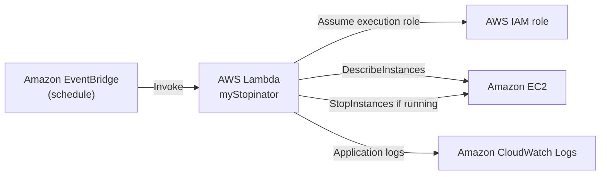

# Scheduled EC2 Stop Automation with AWS Lambda and EventBridge

A small serverless automation lab that uses an Amazon EventBridge schedule to invoke an AWS Lambda function, which checks a configured EC2 instance and stops it when it is running.

> **Lab evidence:** The screenshots below show the EventBridge trigger being added, the Lambda code in the console, and the target EC2 instance in the `stopped` state. The AWS Lambda service landing page is included as introductory context, not as proof of deployment.

## Lab details

| Item | Value |
|---|---|
| Cloud provider | Amazon Web Services (AWS) |
| Region shown in console evidence | `us-east-1` (US East – N. Virginia) |
| Lambda function shown | `myStopinator` |
| Trigger shown | EventBridge schedule named `everyMinute` |
| Runtime version | Not recorded in the available screenshots |
| Completion date | Not recorded in the available screenshots |

## Objective

Automate a simple EC2 lifecycle action without maintaining a continuously running management server. The function checks the configured instance state before requesting a stop, so repeated schedule invocations do not repeatedly attempt to stop an instance that is already stopped.

## Services and components

- **AWS Lambda** — runs the Python automation.
- **Amazon EventBridge Scheduler / scheduled rule** — invokes the function on a schedule. The original console evidence shows a rule named `everyMinute`.
- **Amazon EC2** — the target compute instance.
- **AWS IAM** — grants the Lambda execution role the required EC2 permissions.
- **Amazon CloudWatch Logs** — receives the function's standard application logs when the Lambda execution role has the basic logging permissions.

## Architecture

The function uses the `EC2_INSTANCE_IDS` environment variable to identify the target instance. The IAM policy should restrict `ec2:StopInstances` to that instance ARN. The `ec2:DescribeInstances` action requires a wildcard resource in this policy.

## Implementation

1. Created an EC2 instance to use as the automation target.
2. Created a Lambda execution role and attached the EC2 permissions in [`iam-policy.json`](iam-policy.json).
3. Added the standard `AWSLambdaBasicExecutionRole` managed policy to allow the function to write logs to CloudWatch Logs.
4. Configured the Lambda function using the code in [`lambda_function.py`](lambda_function.py).
5. Set the Lambda environment variable `EC2_INSTANCE_IDS` to a comma-separated list of the intended instance IDs.
6. Added an EventBridge schedule and configured the Lambda function as its target.

### Required configuration

Set the function environment variable:

| Variable | Required | Example |
|---|---:|---|
| `EC2_INSTANCE_IDS` | Yes | `i-0123456789abcdef0` |

The Lambda runtime provides `AWS_REGION`; deploy the function in the same region as the target EC2 instance. Do not commit real instance IDs, account IDs, credentials, or other account-specific values to a public repository.

## Verification and evidence

| Evidence | What it supports |
|---|---|
| [EventBridge trigger added](Screenshots/01-eventbridge-trigger.jpeg) | The console reported that the `everyMinute` trigger was successfully added to `myStopinator`. |
| [Lambda function code](Screenshots/02-lambda-function-code.jpeg) | Shows the original console implementation and the target instance ID used during the lab. |
| [AWS Lambda service page](Screenshots/03-aws-lambda-service-page.jpeg) | Introductory service-console context only; it does not verify this deployment. |
| [EC2 instance stopped](Screenshots/04-ec2-instance-stopped.jpeg) | The selected EC2 instance is displayed in the `Stopped` state. |

The screenshots support the configuration and observed instance state. They do not independently establish the exact IAM policy attached at execution time, CloudWatch log contents, or a repeatable end-to-end test from a clean deployment.

## Security considerations

- Keep the target instance IDs in Lambda environment configuration rather than hard-coding them in source.
- Scope `ec2:StopInstances` to the intended EC2 instance ARN. The policy contains a clearly marked ARN placeholder that must be replaced before use.
- `ec2:DescribeInstances` uses `Resource: "*"` because this action does not support resource-level restriction in the same way as `StopInstances`.
- Attach `AWSLambdaBasicExecutionRole` for standard CloudWatch logging; do not add broad log permissions to the EC2 policy.
- Avoid exposing AWS account identifiers, usernames, instance IDs, or console details in screenshots published to a public repository. Replace evidence images with redacted copies where necessary.

## Cost and cleanup

A one-minute schedule can invoke the function frequently and generate unnecessary Lambda invocations and CloudWatch log ingestion. It was the schedule visible in the original lab evidence, not a recommended production interval. Disable or delete the schedule when the demonstration is complete.

After testing, remove the EventBridge schedule, Lambda function, execution role and inline policy, and the EC2 instance if it is no longer needed. Also check for any other billable resources created during the exercise.

## Limitations and possible next steps

- The screenshots do not record the Lambda runtime version or the lab completion date.
- The original evidence shows the target instance stopped, but does not include a CloudWatch log excerpt or a saved EventBridge invocation history.
- A production implementation should use an operational schedule, explicit error handling/notifications, and a controlled target-selection mechanism such as approved resource tags.
