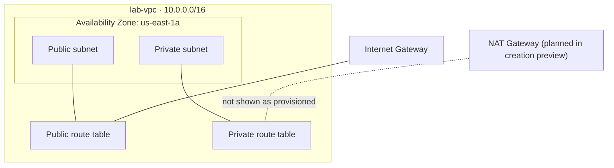

# Secure Network Design on AWS: VPC, Subnets, Security Groups and EC2

This lab explores the building blocks of an isolated AWS network and basic EC2 operational safeguards. The committed console evidence shows a custom VPC, a public/private subnet design preview, regional VPC resources, and the resulting VPC details.

## Lab details

| Item | Value |
|---|---|
| Platform | Amazon Web Services |
| Region shown in console | `us-east-1` (US East – N. Virginia) |
| VPC name | `lab-vpc` |
| VPC CIDR shown | `10.0.0.0/16` |
| VPC state shown | Available |
| DNS hostnames / resolution | Enabled |
| Course source / completion date | Not recorded in available evidence |

## Objectives

- Create a custom VPC with public and private subnet separation.
- Understand how route tables, Internet Gateways, NAT Gateways, security groups, and network ACLs fit into VPC networking.
- Launch and operate EC2 instances while using service-level protections.

## Architecture

The VPC creation preview shows two subnets in `us-east-1a`, labelled `lab-subnet-public1-us-east-1a` and `lab-subnet-private1-us-east-1a`, with separate public and private route tables.

The NAT Gateway is shown as a selected option in the VPC creation preview, but the regional VPC dashboard screenshot reports zero NAT Gateways. Therefore, this repository does not claim that a NAT Gateway was successfully provisioned or that private-subnet outbound routing was tested.

## Work performed

1. Configured a custom VPC named `lab-vpc` with IPv4 CIDR `10.0.0.0/16`.
2. Used the VPC creation workflow to define public and private subnets in `us-east-1a`.
3. Reviewed the VPC dashboard and resource inventory, including subnets, route tables, Internet Gateways, and network ACLs.
4. Reviewed the custom VPC details and confirmed the console showed its state as `Available`, with DNS hostnames and DNS resolution enabled.
5. The broader lab objectives also covered EC2 web-server operations, HTTP security-group rules, termination protection, stop protection, and instance resizing. The current three-image evidence set does not independently verify each of those actions.

## Evidence

| Screenshot | What it demonstrates |
|---|---|
| [VPC creation preview](Screenshots/01-vpc-creation-preview.jpeg) | Two-subnet public/private design preview, route tables, and NAT Gateway selection during configuration. |
| [VPC regional dashboard](Screenshots/02-vpc-regional-resource-dashboard.jpeg) | Regional resource counts, including VPCs, subnets, route tables, Internet Gateways, network ACLs, and zero NAT Gateways at capture time. |
| [Custom VPC details](Screenshots/03-lab-vpc-details.jpeg) | `lab-vpc` is Available with CIDR `10.0.0.0/16` and DNS features enabled. |

## Security and operational notes

- A subnet being named public or private does not alone enforce its exposure; route-table associations and security-group/network-ACL rules determine actual traffic paths.
- Apply least-privilege inbound rules and restrict administrative access to trusted source addresses.
- A NAT Gateway has hourly and data-processing charges. Do not leave one running when it is not required.
- The screenshots include AWS account/user context and resource identifiers. Redact account-specific details before reusing evidence outside this repository.

## Cost and cleanup

The screenshots do not prove whether every resource was deleted after the exercise. Before ending a lab, inspect the VPC, EC2, NAT Gateway, Elastic IP, load balancer, and storage inventories. Delete resources that are no longer required and verify that billable resources have reached their deleted or terminated state.

## Evidence limitations

The current evidence confirms the VPC configuration and dashboard inventory. It does not include a readable security-group rule set, route-table entries, a successful NAT Gateway state, EC2 web-server response, or stop/termination-protection test result. Those items should only be added as verified claims if supporting evidence is captured.
