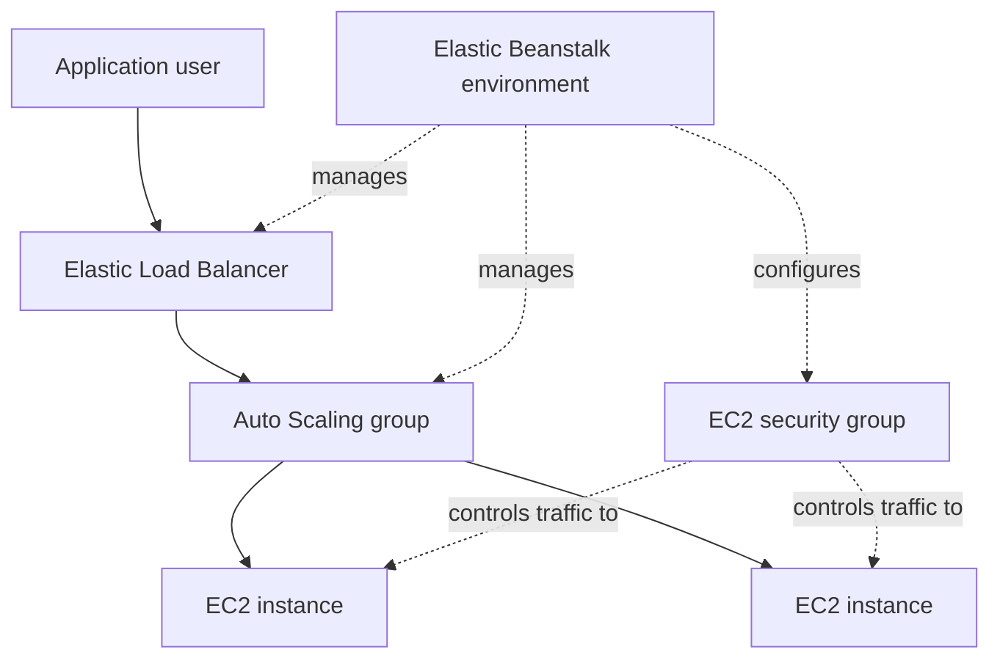

# Application Deployment with AWS Elastic Beanstalk

This lab deploys a sample application through AWS Elastic Beanstalk and inspects the AWS infrastructure managed by the environment, including EC2 instances, a load balancer, Auto Scaling configuration, and security groups.

## Lab details

| Item | Value |
|---|---|
| Platform | Amazon Web Services |
| Region shown in console | `us-east-1` (US East – N. Virginia) |
| Elastic Beanstalk platform shown | Tomcat 9 with Corretto 11 |
| Operating system shown | 64-bit Amazon Linux 2023 |
| Environment type shown | Load balanced |
| Minimum / maximum instances shown | 2 / 6 |
| Scaling cooldown shown | 360 seconds |
| Completion date | Not recorded in available evidence |

## Objective

Understand how a managed application platform deploys application code and provisions supporting infrastructure, while learning where to inspect environment health, capacity, load balancing, and security configuration.

## Architecture

The console evidence shows a load-balanced Elastic Beanstalk environment, an associated load balancer, EC2 instances, and an environment security group. The following is a conceptual view of the components; it is not a claim that every scaling action was triggered during the lab.

## Work performed

1. Created an Elastic Beanstalk application and a load-balanced environment.
2. Deployed the sample application to the environment.
3. Inspected the environment overview and its health status.
4. Reviewed the platform configuration, including Tomcat 9 with Corretto 11 on Amazon Linux 2023.
5. Inspected the environment's instance traffic and scaling configuration. The screenshot shows a minimum capacity of 2 and maximum capacity of 6 instances.
6. Inspected the EC2 instance list, load balancer inventory, and associated security-group inventory.
7. Opened the environment URL and observed the default AWS Elastic Beanstalk congratulations page.

## Evidence and verification

| Screenshot | What it demonstrates |
|---|---|
| [EC2 instances](Screenshots/01-ec2-instances.jpeg) | Two EC2 instances displayed as Running, with 3/3 status checks passed at capture time. |
| [Load balancer inventory](Screenshots/02-load-balancer-inventory.jpeg) | A Classic Load Balancer entry associated with the environment's VPC. |
| [Environment scaling configuration](Screenshots/03-environment-scaling-configuration.jpeg) | Load-balanced environment, minimum capacity 2, maximum capacity 6, and a 360-second cooldown. |
| [Environment overview](Screenshots/04-elastic-beanstalk-environment-overview.jpeg) | Environment health displayed as `Ok`; platform and application version information. |
| [Security-group inventory](Screenshots/05-environment-security-group.jpeg) | The environment's security group is present in the EC2 security-group inventory. |
| [Deployed application page](Screenshots/06-deployed-sample-application.jpeg) | The environment URL serves the default Elastic Beanstalk sample success page. |

The screenshots establish the observed environment health and sample page at capture time. They do not prove that an Auto Scaling event was triggered or that the environment was subsequently terminated.

## Security and operational notes

- Review the environment security group's inbound and outbound rules; expose only the ports required by the application.
- Use HTTPS with a suitable certificate for production traffic.
- Avoid publishing environment URLs, account identifiers, resource IDs, or usernames if they are not intended to be public.
- A load-balanced environment with a minimum capacity of two can incur ongoing EC2 and load-balancer charges even when traffic is low.

## Cost and cleanup

The earlier README stated that the environment was terminated, but the available screenshots do not show the termination result. Treat cleanup as unverified until the Elastic Beanstalk environment and its dependent resources are confirmed deleted. Check EC2 instances, load balancers, Auto Scaling groups, EBS volumes, Elastic IPs, and CloudWatch logs for remaining charges.

## Possible next steps

- Capture a successful Auto Scaling activity-history event.
- Add a screenshot of the environment's inbound security-group rules after reviewing source ranges.
- Configure HTTPS and a custom domain in a separate exercise.
