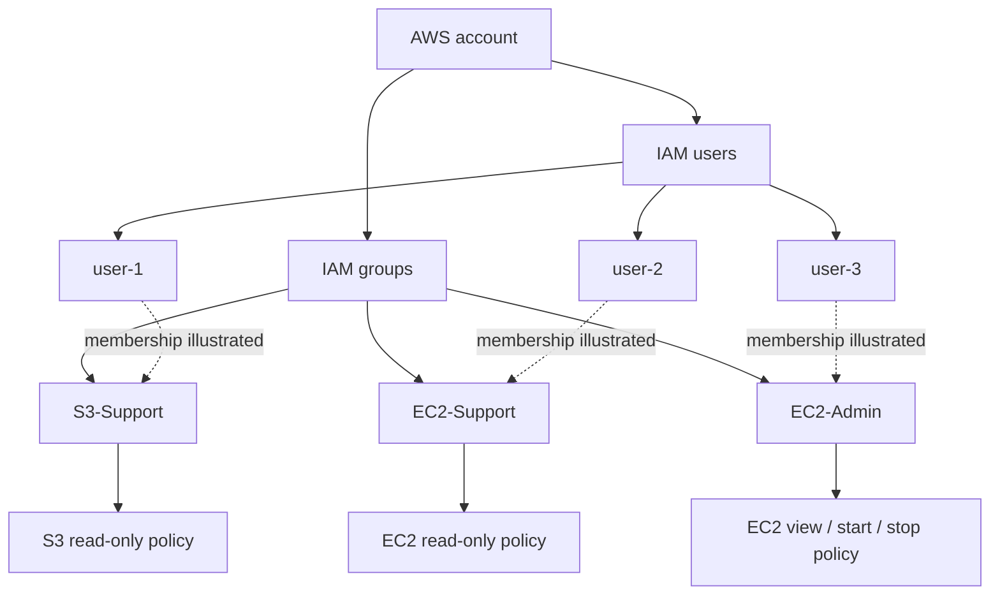

# AWS IAM: Users, Groups and Policies

This guided AWS Academy lab explores how IAM users receive permissions through groups and how identity-based policies control access to AWS services.

## Lab details

| Item | Value |
|---|---|
| Platform | Amazon Web Services |
| Source shown in existing documentation | AWS Academy Cloud Foundations guided lab |
| Console scope | Global IAM dashboard |
| Region shown in service screenshots | `us-east-1` for EC2 and S3 examples |
| Completion date | Not recorded in available evidence |

## Objective

Understand the relationship between IAM users, groups, and policies, and why permissions are generally easier to manage consistently through groups rather than attaching separate policies to every user.

## Access model covered

The lab's supplied conceptual diagram illustrates three groups and their intended access:

| Group | Intended permission scope | Example user shown |
|---|---|---|
| EC2-Admin | EC2 view, start, and stop | user-3 |
| EC2-Support | EC2 read-only | user-2 |
| S3-Support | S3 read-only | user-1 |

This table describes the access model illustrated in the diagram. The current screenshots do not include the full JSON policy documents or policy-simulator results, so the exact effective permissions have not been independently verified here.

## Conceptual relationship

## Work performed

1. Reviewed the IAM dashboard and explored the user, group, role, and policy areas.
2. Inspected the supplied user/group access model.
3. Explored the AWS sign-in URL area for IAM users.
4. Reviewed the example S3 and EC2 service consoles while working through the permission scenarios.
5. Considered how different group policy scopes should allow or deny access to specific services and actions.

## Evidence

| Screenshot | What it demonstrates |
|---|---|
| [IAM users and groups model](Screenshots/01-iam-user-group-policy-model.jpeg) | Conceptual mapping of three users to EC2-Admin, EC2-Support, and S3-Support groups. |
| [IAM dashboard](Screenshots/02-iam-dashboard.jpeg) | IAM dashboard showing 3 user groups, 4 users, 14 roles, and 1 policy at capture time. |
| [S3 console](Screenshots/03-s3-bucket-console.jpeg) | S3 console accessed in a session labelled `user-1`; one bucket is listed. |
| [EC2 console](Screenshots/04-ec2-console.jpeg) | EC2 console accessed in a session labelled `user-2`; the dashboard lists two running instances. |

The service-console screenshots are contextual evidence. They do not by themselves prove that a specific action was permitted or denied by the intended policy.

## Security takeaways

- Prefer assigning permissions to groups and managing group membership over duplicating policies across individual users.
- Apply least privilege: grant only the actions and resources required for each role.
- Use MFA for human identities and avoid using the root user for routine tasks.
- Review unused users, access keys, and overly broad policies regularly.
- Use IAM policy simulation and controlled sign-in tests to verify both allowed and denied actions.

## Cost and cleanup

IAM itself does not incur a direct charge for these basic identity resources, but any EC2 or S3 resources used during permission testing may incur charges. Remove temporary test resources and review the account before ending the lab. Do not delete shared or course-managed identities without confirming that they are safe to remove.

## Evidence limitations and next steps

The repository currently does not contain the actual IAM policy JSON documents, group membership screenshots from the IAM console, MFA settings, or policy-simulator results. Capture these in a future update if you want to claim that each user's effective permissions were tested. Redact account identifiers and sign-in URL details from public screenshots.
