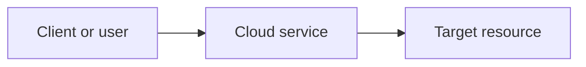

# [Lab title]

> One or two sentences describing the task performed and the practical outcome.

**Platform:** AWS / Huawei Cloud  
**Exercise type:** Guided training lab / self-directed lab  
**Completion:** Completed / In progress  
**Date:** [Month YYYY, if known]  
**Region:** [Region, if relevant and safe to disclose]

## 1. Objective

Describe the task and the technical capability being practiced.

## 2. Services and components

- [Cloud service]
- [Supporting service or client]
- [Relevant protocol or tool]

## 3. Architecture

Use a Mermaid diagram that reflects the actual lab configuration. Do not include components that were not deployed or tested.

Explain the important traffic, data, or control paths below the diagram.

## 4. Implementation

Document the main configuration steps. Include important settings only when they are known and verified.

1. [Configuration step]
2. [Configuration step]
3. [Configuration step]

## 5. Verification and results

Explain how the configuration was tested and what was observed.

- **Test:** [What was tested]
- **Expected behavior:** [Expected result]
- **Observed result:** [Actual result]

Add screenshots or sanitized command output when available. Use descriptive filenames, for example `screenshots/rds-instance-overview.png`.

## 6. Security and operational considerations

Record relevant access-control, network-exposure, backup, monitoring, availability, and cost considerations. Clearly distinguish settings actually configured from recommendations for future improvement.

## 7. Key takeaways

- [Practical learning]
- [Operational insight]
- [Security consideration]

## 8. Cleanup and cost

State whether resources were deleted or are still present. Mention any services that may continue to incur charges.

## 9. Possible improvements

- [A realistic next step]
