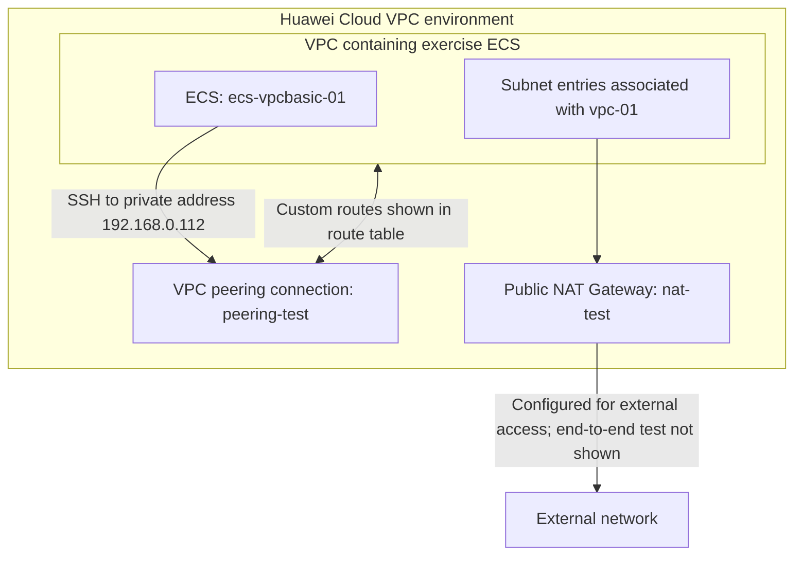

# Huawei Cloud VPC Basics and Networking Exercises

> Hands-on Huawei Cloud exercise covering VPC and subnet setup, network security controls, and connectivity through NAT Gateway and VPC peering.

**Platform:** Huawei Cloud  
**Exercise type:** Guided hands-on training lab  
**Region visible in console evidence:** AP-Singapore  
**Status:** Exercise completed; evidence reviewed from supplied screenshots

## 1. Objectives

The exercise objectives were to:

- Create VPCs and subnets.
- Configure security groups and Network ACLs to improve the security of resources in a VPC.
- Configure VPC peering connections and NAT gateways.

## 2. Services and components

- **Virtual Private Cloud (VPC):** isolated virtual networks for cloud resources.
- **Subnets:** network segments configured within a VPC.
- **Elastic Cloud Server (ECS):** instances used in the exercise to test connectivity and security rules.
- **Security Groups:** instance-level traffic control.
- **Network ACLs:** subnet-level network access control.
- **VPC Peering:** private connectivity between VPCs.
- **Public NAT Gateway:** network address translation for VPC resources that need external network access.

## 3. Exercise structure

The official exercise is organized into three configuration areas:

### 3.1 VPC basic configurations

1. Create a VPC.
2. Create subnets.

### 3.2 VPC security configurations

1. Create and manage security groups.
2. Create two ECS instances to test whether security-group rules take effect.
3. Create and manage Network ACLs.

### 3.3 VPC connectivity configurations

1. Configure a NAT Gateway for internet access.
2. Create a VPC peering connection to connect different VPCs.

The steps above describe the exercise scope. The evidence summary below distinguishes the configurations visible in the supplied screenshots from steps for which a detailed screenshot was not supplied.

## 4. Architecture and connectivity overview

The supplied console captures show a VPC peering route, ECS-to-ECS SSH access, a Public NAT Gateway, and subnet entries. The following is a logical summary of those visible components, not a complete exported topology of every resource created during the exercise.



> The diagram is intentionally conceptual. The collage does not expose all VPC names, CIDR blocks, route destinations, subnet-to-gateway associations, or the complete peering topology. Those details are not inferred.

## 5. Implementation and evidence reviewed

### 5.1 VPC and subnet configuration

The subnet console capture shows two subnet rows associated with **vpc-01**. The IPv4 CIDR values are truncated, so the exact subnet ranges are not listed. The screenshot also exposes a VPC identifier; this should be redacted in a public-safe copy.

### 5.2 Security groups and Network ACLs

The official exercise includes creating and managing security groups, testing their rules with two ECS instances, and creating and managing Network ACLs.

The supplied VPC collage does not show the actual security-group or Network ACL rule tables. Therefore, this README records these as exercise topics but does not invent rule directions, protocols, ports, source ranges, or test outcomes.

### 5.3 ECS connectivity test

The Huawei Cloud RemoteShell capture shows a terminal on **ecs-vpcbasic-01** running:

```bash
ssh 192.168.0.112
```

The terminal proceeds through host-key confirmation and password authentication, then displays a last-login message and the Huawei Cloud service welcome message. This is evidence that an SSH session to `192.168.0.112` was established. A separate capture shows six successful ping replies from `192.168.1.5` with 0% packet loss; the screenshot does not prove that this address belongs to the peered VPC.

The screenshot does not identify the destination ECS name or show the complete security-group and Network ACL rules governing the connection.

### 5.4 VPC peering and route tables

The route-table capture shows two custom route entries whose next hop is the VPC peering connection **peering-test**.

The destination CIDR values are cropped, so they are not reproduced here. The capture supports documenting the presence of custom routes using the peering connection as the next hop; it does not independently show a complete end-to-end connectivity test between both VPCs.

### 5.5 Public NAT Gateway

The Public NAT Gateways console shows a gateway named **nat-test** with:

- **Status:** Normal
- **Scenario:** VPC
- **CIDR block shown:** 192.168.0.0/24

The public IP field is partially visible in the collage and is intentionally omitted. The screenshot confirms the gateway's displayed status and CIDR block, but does not by itself prove that an ECS instance successfully reached the internet through the gateway.

## 6. Verification summary

| Area | Evidence visible | What can be stated |
|---|---|---|
| VPC and subnets | Two subnet rows associated with vpc-01 | Subnet entries are present; exact CIDRs are cropped |
| ECS connectivity | SSH session to 192.168.0.112 reaches the remote login banner | SSH login succeeded |
| ICMP connectivity | Six ping replies from 192.168.1.5; 0% packet loss | ICMP connectivity to that address succeeded from the shown ECS session |
| VPC peering | Two custom route entries use peering-test as next hop | Peering connection is referenced by custom routes |
| Public NAT Gateway | nat-test shows Normal; CIDR 192.168.0.0/24 | Gateway is present and displayed as Normal |
| Security groups | Covered in official exercise instructions | Specific rules and test results are not visible in supplied collage |
| Network ACLs | Covered in official exercise instructions | Specific ACL rules and test results are not visible in supplied collage |
| Internet egress | NAT Gateway configuration is visible | Successful internet access test is not shown |

## 7. Security and operational considerations

- Apply least-privilege rules to security groups and Network ACLs. Permit only the required protocols, ports, and source/destination ranges.
- Keep SSH access restricted to trusted administrative sources; avoid exposing management access broadly.
- For VPC peering, review both sides' route tables and ensure the intended network ranges do not conflict.
- Review NAT Gateway SNAT rules and associated subnet routing before relying on it for outbound access.
- Avoid publishing public IP addresses, account identifiers, credentials, or other sensitive console details in screenshots.
- A gateway status of **Normal** indicates the displayed resource status; it is not a substitute for an end-to-end connectivity test.

These are security and operational recommendations, not claims that every control was configured or tested in this exercise.

## 8. Key takeaways

- Practiced the core Huawei Cloud VPC workflow: networks, subnets, security controls, and connectivity.
- Observed custom route entries that use a VPC peering connection as the next hop.
- Established an SSH session to a private ECS address from Huawei Cloud RemoteShell.
- Reviewed a Public NAT Gateway displayed in Normal status.
- Identified the importance of validating route tables, security rules, and end-to-end connectivity separately.

## 9. Evidence and possible improvements

The original screenshots are now stored individually in `Screenshots/` and linked below. The files still require a publication-safety review because some captures expose console usernames, public IP information, or account context.

To make this lab record more complete, add sanitized original screenshots showing:

- VPC and subnet details, including full CIDR blocks.
- Security-group inbound and outbound rules.
- Network ACL rules and the two-ECS rule-effect tests.
- Both sides of the VPC peering connection and their route tables.
- NAT Gateway SNAT configuration and a successful outbound connectivity test.

Do not publish passwords, private keys, account identifiers, or sensitive public IP information.
