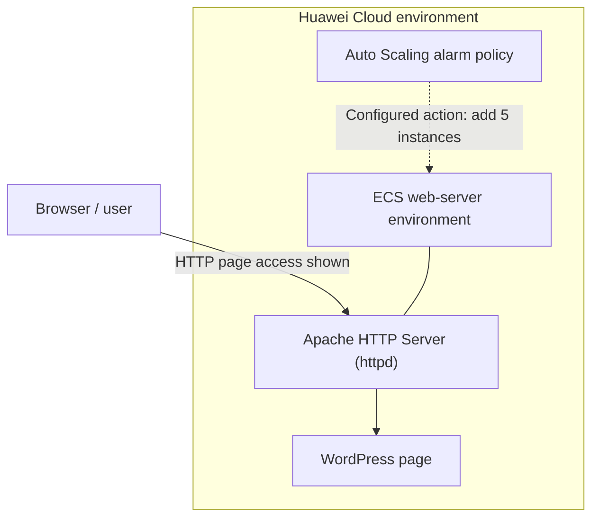

# Huawei Cloud Scalable Web Architecture: Web Server, WordPress and Auto Scaling

> Hands-on exercise evidence covering Apache web-server setup, WordPress accessibility, and a CPU-based Auto Scaling policy in Huawei Cloud.

**Platform:** Huawei Cloud  
**Exercise type:** Guided hands-on training lab  
**Region visible in console evidence:** AP-Singapore  
**Status:** Evidence reviewed from supplied screenshots

## 1. Exercise context

The lab material focuses on hosting a web application on Huawei Cloud and introducing scalability through Auto Scaling. The supplied screenshot collage provides evidence of an Apache web server, a WordPress page, and an Auto Scaling policy.

This README separates those visible results from other architecture components that are not established by the supplied captures.

## 2. Services and components visible in the evidence

- **Elastic Cloud Server (ECS):** browser tabs and RemoteShell context indicate work with ECS instances.
- **Apache HTTP Server:** terminal output shows the service starting, and an Apache test page is visible in a browser.
- **WordPress:** a WordPress welcome/dashboard page is visible at a path containing `/wordpress/wp-admin/`.
- **Auto Scaling (AS):** the console shows a configured alarm-based scaling policy.

The collage also contains browser tabs referring to Relational Database Service (RDS), Data Admin, and Load Balancing. Their presence in the browser tabs alone is not treated as proof that a database connection or load-balancer test was completed.

## 3. Auto Scaling policy

The Auto Scaling policy table shows the following configuration:

| Setting | Value visible in console |
|---|---|
| Policy type | Alarm |
| Monitoring resource | AS Groups (specific resource) |
| Trigger condition | CPU Usage Raw Data ≥ 600% for 3 consecutive periods |
| Scaling action | Add 5 instances |
| Cooldown period | 300 seconds |

The console text also indicates that the alarm is triggered only once even if the trigger conditions persist.

These values are transcribed from the visible policy row. The collage does not show a resulting scale-out event, the Auto Scaling group minimum/maximum capacity, or the monitoring metric's unit and full configuration. Therefore, this document records the configured policy, not a verified automatic scale-out test.

## 4. Web-server setup and application access

### 4.1 Apache HTTP Server

The terminal screenshot shows commands and service output associated with the Apache HTTP Server (`httpd`). The visible output includes:

- A change to the web root directory, `/var/www/html`.
- Commands to start `httpd` and `php-fpm`.
- A service status check for `httpd`.
- Apache foreground-process output ending with **“Started The Apache HTTP Server.”**

A separate browser capture displays the default Apache test page. The page explains that seeing it indicates the web server is installed and responding.

Together, these captures support that Apache was started and its test page was accessible.

### 4.2 WordPress

A browser capture shows a WordPress welcome page with the standard getting-started links, including writing a first blog post, adding an About page, and viewing the site. The visible URL path includes `/wordpress/wp-admin/`.

This supports that a WordPress page was reachable in the browser. The supplied capture does not show the WordPress database configuration or a successful application-to-database verification, so those details are not claimed here.

## 5. Logical component view

The following diagram summarizes only the components supported by the collage. It does not assert that an ELB-to-ECS-to-RDS end-to-end architecture was verified.

## 5.1 Committed screenshot evidence

| Screenshot | Evidence captured |
|---|---|
| [Security-group inventory](Screenshots/01-security-group-inventory.jpg) | Security groups and associated-instance counts |
| [ECS network topology](Screenshots/02-ecs-network-topology.jpg) | ECS `ecs-mp`, security group, network interface, EIP, system disk, and image |
| [Web-stack package installation](Screenshots/03-web-stack-package-install.png) | Package installation output for Apache, MariaDB, PHP, and PHP-FPM |
| [Apache configuration](Screenshots/04-apache-configuration.png) | Apache configuration editor with `ServerName localhost:80` |
| [Apache service running](Screenshots/05-apache-service-running.png) | `httpd` service shown as active (running) |
| [DAS database list](Screenshots/06-das-database-list.png) | DAS page for RDS instance `rds-mp`, MySQL 8.0.43, with a database row |
| [WordPress database setup](Screenshots/07-wordpress-database-setup-page.png) | WordPress setup page requesting database connection details; not proof of a successful DB connection |
| [WordPress admin dashboard](Screenshots/08-wordpress-admin-dashboard.png) | WordPress dashboard reachable over HTTP |
| [Auto Scaling policy](Screenshots/09-auto-scaling-policy.png) | Alarm policy row with CPU Usage Raw Data ≥ 600%, add 5 instances, 300-second cooldown |

## 6. Verification summary

| Area | Screenshot evidence | Supported conclusion |
|---|---|---|
| Apache service | Terminal output reports Apache HTTP Server started | Apache service start is shown |
| Apache page | Default Apache test page is visible | Web server responded in the browser |
| WordPress | WordPress welcome page is visible at a WordPress admin path | WordPress page was accessible |
| Auto Scaling | Alarm policy row shows CPU trigger, add 5 instances, 300-second cooldown | Policy configuration is visible |
| ELB | Load Balancing appears as a browser tab | No ELB configuration or end-to-end test is visible |
| RDS/database | RDS and Data Admin appear as browser tabs | No database setup or application-to-database test is visible |
| Actual scale-out | No before/after instance count or scaling activity is shown | Scale-out execution is not verified |

## 7. Security and operational considerations

- Use security-group rules that expose only the required web ports to intended clients.
- Restrict administrative access such as SSH to trusted source addresses.
- Keep the database tier private and permit access only from the required application tier.
- Configure health checks and monitoring alarms before relying on automated scaling.
- Review the scaling threshold, metric units, evaluation periods, and cooldown behavior to ensure the policy matches the workload.
- Use HTTPS for production-facing web applications and protect WordPress administration access.
- Keep application, database, and cloud credentials out of screenshots and source control.

These are recommendations for a robust deployment; they are not claims that each control was configured in this lab.

## 8. Key takeaways

- Practiced starting and checking the Apache HTTP Server service on a cloud-hosted environment.
- Verified the default Apache test page in a browser.
- Observed a WordPress welcome page served from the web environment.
- Reviewed an alarm-based Auto Scaling policy with a CPU trigger and a configured scale-out action.
- Learned to distinguish a configured scaling policy from a demonstrated scaling event.

## 9. Evidence gaps and possible improvements

The committed screenshots do not show the full architecture diagram, ELB listener/backend configuration, RDS instance settings, a successful WordPress-to-database connection, or an actual Auto Scaling event.

To make the portfolio record more complete, add sanitized screenshots showing:

- ECS instance details and network placement.
- ELB listeners, backend server group, health checks, and website access through the load balancer.
- RDS instance and the WordPress database connection (without credentials).
- Auto Scaling group capacity settings and a scale-out activity record showing the instance count before and after the event.
- Monitoring graph or alarm details that show the metric, unit, and evaluation periods.

The original screenshots are stored individually in `Screenshots/`. Several captures contain a RemoteShell session token in the browser URL, a public IP address, or console identity details. Treat these files as unredacted training evidence and replace them with sanitized copies before public release.
