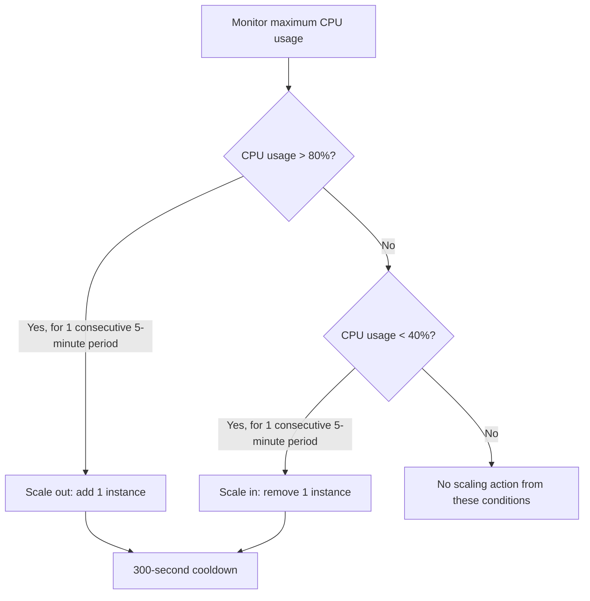

# Huawei Cloud Auto Scaling Policies

> Hands-on Huawei Cloud lab reviewing alarm-based scale-out and scale-in policies, Auto Scaling group capacity, and instance-count settings.

**Platform:** Huawei Cloud  
**Training:** HCCDP Solution Architecture  
**Region visible in console evidence:** AP-Singapore  
**Date recorded in the existing lab notes:** 17 October 2026  
**Status:** Policy configurations and capacity snapshots documented from supplied screenshots

## 1. Objective

The exercise develops practical familiarity with Huawei Cloud Auto Scaling (AS), including how scaling policies respond to monitored conditions and how an Auto Scaling group maintains its configured capacity range.

The supplied screenshots specifically show two alarm-based policies and two Auto Scaling group capacity snapshots.

## 2. Services and concepts

- **Auto Scaling (AS):** manages the number of ECS instances in an Auto Scaling group.
- **Elastic Cloud Server (ECS):** compute instances managed by the group.
- **Alarm-based scaling policy:** performs a scaling action when a monitoring condition is met.
- **Cooldown period:** time interval configured between scaling actions.
- **Minimum and maximum capacity:** lower and upper limits configured for the group.

The original lab notes also mention AS configurations, scheduled or periodic policies, bandwidth scaling, Cloud Eye, and Elastic Load Balance (ELB). Those topics are not demonstrated in the screenshots reviewed for this update, so they are not described as verified implementation results below.

## 3. Alarm-based scaling policies

The Auto Scaling policy console shows separate scale-out and scale-in policies.

### 3.1 Scale-out policy

| Setting | Value visible in console |
|---|---|
| Policy type | Alarm |
| Monitoring resource | AS Groups (specific resource) |
| Metric | CPU Usage Max. |
| Trigger condition | Greater than 80% |
| Evaluation condition | 1 consecutive period |
| Monitoring interval | 5 minutes |
| Scaling action | Add 1 instance |
| Cooldown period | 300 seconds |

The console description states that the alarm is triggered only once even if the trigger conditions persist.

### 3.2 Scale-in policy

| Setting | Value visible in console |
|---|---|
| Policy type | Alarm |
| Monitoring resource | AS Groups (specific resource) |
| Metric | CPU Usage Max. |
| Trigger condition | Less than 40% |
| Evaluation condition | 1 consecutive period |
| Monitoring interval | 5 minutes |
| Scaling action | Reduce 1 instance |
| Cooldown period | 300 seconds |

The console description also states that the alarm is triggered only once even if the trigger conditions persist.

> The metric name, thresholds, evaluation period, monitoring interval, actions, and cooldown are transcribed from the visible policy rows. The screenshots do not show the full metric definition or a time-series graph.

## 4. Auto Scaling group capacity

Two separate console snapshots show the following capacity values:

| Snapshot | Expected instances | Current instances | Minimum | Maximum |
|---|---:|---:|---:|---:|
| A | 2 | 2 | 1 | 3 |
| B | 1 | 1 | 1 | 3 |

Both snapshots show zero protected and zero standby instances. The visible last-action panel shows zero removed and zero waiting instances.

These are two observed console states. Additional screenshots now show a successful action explicitly labelled `Triggered by Alarm. Remove 1 instance` for policy `as-policy-service02`. This supports that an alarm-triggered scale-in action was reported as successful. Another screenshot shows a separate manual removal action; these two events must not be conflated. A separate scale-out snapshot reports `Triggered by Expected instances. Add 2...`, which is not proof of an alarm-triggered scale-out.

## 5. Logical scaling behavior

The following diagram explains the intent of the two configured policies. It represents policy logic, not a captured event timeline.

The Auto Scaling group capacity range visible in the screenshots is minimum 1 and maximum 3 instances. Actual policy execution remains subject to the group's configured capacity limits.

## 5.1 Committed screenshot evidence

| Screenshot | Evidence captured |
|---|---|
| [AS group capacity and add action](Screenshots/01-as-group-capacity-and-add-action.jpg) | Expected/current capacity 2/2; last action reports adding two instances and Successful |
| [Scale-out alarm policy](Screenshots/02-scale-out-alarm-policy.jpg) | CPU Usage Max. greater than 80% for one 5-minute period; add one instance; 300-second cooldown |
| [CPU stress script error](Screenshots/03-cpu-stress-script-error.png) | Attempted script execution fails with a shell syntax error; load generation is not verified |
| [Monitoring metrics](Screenshots/04-monitoring-metrics.jpg) | Monitoring graphs with a visible CPU peak and request/traffic metrics |
| [Manual scale-in action](Screenshots/05-manual-scale-in-action.jpg) | Last action explicitly marked Triggered by Manual; remove one instance; Successful |
| [Scale-in alarm policy](Screenshots/06-scale-in-alarm-policy.jpg) | CPU Usage Max. below 40% for one 5-minute period; reduce one instance; 300-second cooldown |
| [CPU and instance-count metrics](Screenshots/07-cpu-and-instance-count-metrics.jpg) | CPU and instance-count time series shown together; does not alone establish causality |
| [Successful alarm-triggered scale-in](Screenshots/08-successful-alarm-scale-in.jpg) | Last action marked Triggered by Alarm for `as-policy-service02`; remove one instance; Successful |

## 6. Verification summary

| Area | Evidence visible | Supported conclusion |
|---|---|---|
| Scale-out policy | CPU Usage Max. > 80%; 1 consecutive period; 5-minute monitoring interval; add 1; cooldown 300 seconds | Scale-out policy configuration is visible |
| Scale-in policy | CPU Usage Max. < 40%; 1 consecutive period; 5-minute monitoring interval; reduce 1; cooldown 300 seconds | Scale-in policy configuration is visible |
| Group capacity | Expected/current counts of 2/2 and 1/1 | Two capacity snapshots are visible |
| Capacity boundaries | Minimum 1, maximum 3 | Group capacity range is visible |
| Scaling activity | Last-action panel reports `Triggered by Alarm. Remove 1 instance` for `as-policy-service02`, status Successful | One alarm-triggered scale-in action is evidenced; the exact metric sample that caused it is not shown |
| Manual scaling | Separate last-action panel reports `Triggered by Manual. Remove 1 instance`, status Successful | Manual removal is evidenced separately from alarm-based scaling |
| Scale-out action | Last-action panel reports `Triggered by Expected instances. Add 2...`, status Successful | Capacity adjustment is shown, but the capture does not attribute it to the CPU alarm policy |
| ELB integration | No ELB association or health-check screenshot in this batch | Load-balancer integration is not verified by this evidence |

## 7. Security and operational considerations

- Set minimum and maximum instance counts to values that balance availability and cost.
- Use scale-out and scale-in thresholds with enough separation to reduce unnecessary repeated changes.
- Review metric definitions, units, evaluation periods, and cooldown behavior before relying on a policy.
- Confirm that new instances receive the correct image, software configuration, security groups, and subnet placement.
- If using a load balancer, verify backend health checks and confirm that new instances become healthy before relying on them to serve traffic.
- Monitor scaling activity and instance health rather than treating a configured policy as proof that scaling has occurred.

These are operational recommendations, not claims that each item was configured or tested in this lab.

## 8. Key takeaways

- Reviewed alarm-based scaling in both directions: adding and removing ECS instances.
- Compared a high-CPU scale-out threshold with a low-CPU scale-in threshold.
- Observed a 300-second cooldown configured for both policies.
- Reviewed an Auto Scaling group with a minimum of one and maximum of three instances.
- Distinguished policy configuration and capacity snapshots from confirmed policy-triggered scaling events.

## 9. Evidence gaps and possible improvements

The committed screenshots do not show:

- Auto Scaling activity history proving that either alarm policy executed.
- A CPU monitoring graph showing the threshold being crossed.
- The full AS configuration or instance template.
- Scheduled/periodic or bandwidth scaling policy details.
- ELB association, backend health checks, or traffic distribution.

For a stronger portfolio record, add sanitized screenshots of the alarm metric graph, scaling activity history, AS configuration, and (if included in the exercise) ELB backend association and health status. Avoid publishing account identifiers, session tokens, credentials, or sensitive IP information.

The screenshots are now committed individually under `Screenshots/`. One CPU-stress script capture shows a shell syntax error, so that attempt must not be described as a successful load-generation test.
