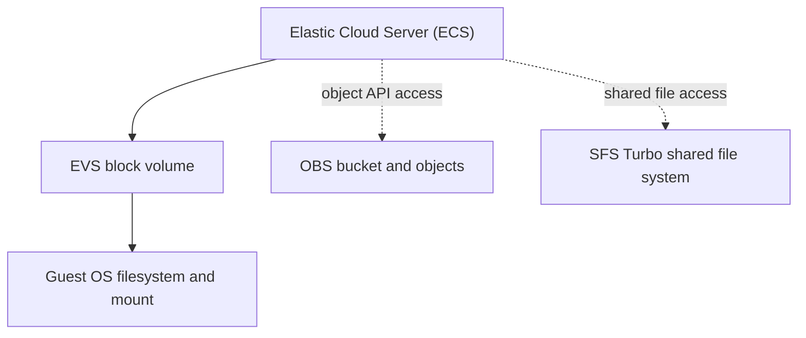

# Huawei Cloud Storage Services: EVS, OBS and SFS Turbo

> Hands-on storage exercise covering block storage, object storage, and shared file storage on Huawei Cloud.

**Platform:** Huawei Cloud  
**Training:** HCCDP Solution Architecture  
**Region shown in original console captures:** AP-Singapore  
**Evidence status:** EVS Linux/Windows evidence retained; OBS evidence withheld pending redaction; SFS remains unverified.

## 1. Objectives

The training exercise covers three Huawei Cloud storage services:

1. **EVS (Elastic Volume Service):** block storage attached to ECS instances.
2. **OBS (Object Storage Service):** object storage organized into buckets and objects.
3. **SFS Turbo (Scalable File Service):** managed shared file storage accessed by supported clients.

The exercise outline includes preparing EVS disks on Windows and Linux, managing OBS buckets and objects, and provisioning/mounting SFS Turbo. This README distinguishes the exercise objectives from the activities demonstrated by the available evidence.

## 2. EVS — Elastic Volume Service

EVS provides persistent block volumes that can be attached to ECS instances and prepared by the guest operating system.

### Linux disk preparation

The retained terminal captures show the following sequence on a Linux ECS:

1. `fdisk -l` identifies an additional 21.5 GB block device at `/dev/vdb`.
2. A primary Linux partition, `/dev/vdb1`, is created with an approximate size of 10 GiB.
3. `mkfs -t ext4 /dev/vdb1` creates an ext4 filesystem.
4. The mount point `/mnt/sdc` is created.
5. `/dev/vdb1` is mounted at `/mnt/sdc`, and `df -TH` lists the ext4 filesystem at that mount point.

The terminal capture also shows an earlier mount attempt with an incorrectly combined device/path argument. The subsequent corrected command succeeds. The successful mount is the relevant result.

A separate terminal capture shows a different device, `/dev/vdc1`, being mounted at `/mnt/sdc`. The later attempt to change into `/mnt/sdc/snapshot` fails because that path does not exist. The command `cat test.file` then reads a file from the shell's current directory. This is **not** evidence that the file was read from the mounted filesystem.

### Windows disk view

The Windows Disk Management capture shows:

- Disk 1 online with a capacity of 20 GB.
- A 20 GB NTFS volume assigned drive letter `D:`.
- The volume status displayed as Healthy (Primary Partition).

The screenshot shows the resulting disk/volume state; it does not show the complete initialization and formatting sequence.

### EVS evidence

| Evidence | What it supports | Limitation |
|---|---|---|
| [Windows Disk Management](Screenshots/01-windows-disk-management.png) | A 20 GB NTFS `D:` volume is online and healthy | Initial disk setup steps are not shown |
| [Linux disk partition table](Screenshots/04-linux-disk-partition-table.png) | An additional `/dev/vdb` disk is visible | Does not alone prove cloud attachment details |
| [Linux partition creation](Screenshots/05-linux-partition-creation.png) | A Linux partition `/dev/vdb1` is created | Partitioning only |
| [Linux ext4 formatting](Screenshots/06-linux-ext4-formatting.png) | `/dev/vdb1` is formatted as ext4 | Does not prove persistence after reboot |
| [Linux filesystem mount](Screenshots/07-linux-filesystem-mount.png) | `/dev/vdb1` is mounted at `/mnt/sdc`; `df -TH` lists it | No reboot/persistent-mount test is shown |
| [Linux file-read attempt](Screenshots/08-linux-file-read-test.png) | A separate mount command for `/dev/vdc1` succeeds; a file is read from the current directory | The file read is not demonstrated from the mounted path |

## 3. OBS — Object Storage Service

The original Task Center capture displayed a successful task for an object named `obs-test` in a bucket named `bucket-vivi`, with a reported size of **0 Bytes**.

This is limited evidence of a successful task record for a zero-byte object. It does not establish a non-empty upload/download, content integrity, or the complete bucket lifecycle. The original console screenshot is withheld from this branch until account and resource details are redacted.

Recommended follow-up evidence:
- Bucket details with account identifiers removed.
- Upload and download of a non-empty test file.
- Matching file size or checksum after download.
- Object deletion confirmation, if performed.

## 4. SFS Turbo — shared file storage

The exercise outline includes creating an SFS Turbo file system and mounting it to Linux and Windows ECS instances. The available screenshot set does not contain an SFS resource, provisioning status, or client mount. SFS is therefore recorded as **not verified**; no completion claim is made.

To verify this part of the exercise, capture:
- SFS Turbo resource details and an Available/usable status.
- Linux NFS client setup and mount verification.
- Windows client setup and mount verification, if included in the lab.
- A shared-file test showing access from the intended clients.

## 5. Conceptual storage overview

The diagram below summarizes the service roles; it is conceptual and does not claim that all three services were deployed or integrated in this exercise.

## 6. Verification summary

| Service | Demonstrated by available evidence | Not established |
|---|---|---|
| EVS | Windows NTFS volume view; Linux partitioning, ext4 formatting, and mount | Full cloud attachment lifecycle, reboot persistence, snapshot/restore, and verified file I/O on the mounted path |
| OBS | A successful Task Center record for a zero-byte object (original image withheld pending redaction) | Non-empty upload/download, checksum validation, and full bucket lifecycle |
| SFS Turbo | Included in the training objectives only | Provisioning, Linux/Windows mounts, and cross-client shared-file access |

## 7. Key takeaways

- EVS provides block devices that the guest operating system partitions, formats, and mounts.
- OBS stores data as objects inside buckets and should be tested with non-empty files and integrity checks.
- SFS Turbo is intended for shared file access; a resource and client-side mount test are needed before claiming successful deployment.
- Good lab documentation separates the intended exercise from what the captured evidence actually verifies.

## 8. Publication and evidence notes

The original console screenshots included account/agency identifiers, resource identifiers, a public IP address, and Remote VNC session-token URLs. The affected console/VNC images have been removed from this review branch pending redaction. The retained Windows and Linux terminal screenshots are limited to the evidence linked above, but should still receive a final visual review before publication.

No Huawei Cloud resources were changed as part of this repository documentation work.
