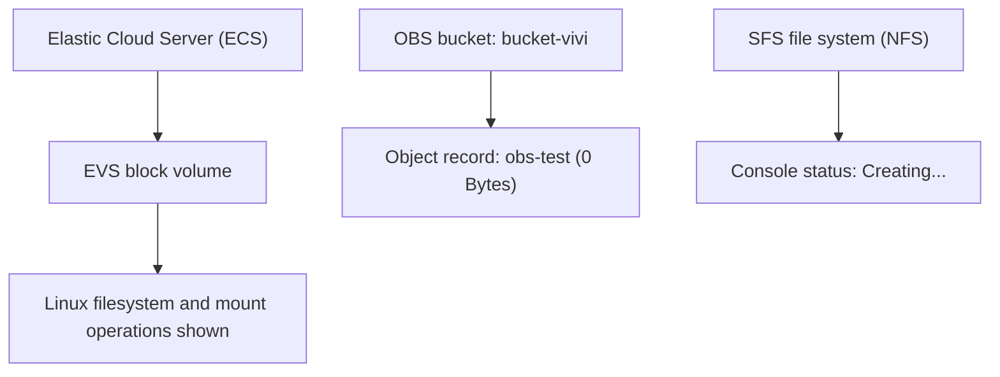

# Huawei Cloud Storage Services: EVS, OBS and SFS Turbo

> Hands-on storage exercise covering block storage, object storage, and shared file storage on Huawei Cloud.

**Platform:** Huawei Cloud  
**Training:** HCCDP Solution Architecture  
**Region visible in console evidence:** AP-Singapore  
**Status:** Evidence reviewed from supplied screenshot collage

## 1. Objectives

The official exercise covers three Huawei Cloud storage services:

1. **EVS (Elastic Volume Service):** block storage practice.
2. **OBS (Object Storage Service):** object storage practice.
3. **SFS (Scalable File Service):** shared file storage practice.

The exercise outline includes attaching and initializing EVS disks on Windows and Linux ECS instances, creating and managing OBS buckets and objects, and creating and mounting an SFS Turbo file system to Linux and Windows ECS instances.

## 2. Services and concepts

- **EVS:** persistent block storage volumes attached to ECS instances.
- **OBS:** object storage organized into buckets and objects.
- **SFS Turbo:** managed shared file storage; the supplied console row identifies the NFS protocol.
- **ECS:** compute instances used to access storage services.

## 3. EVS — Elastic Volume Service

### 3.1 Linux disk preparation

The supplied terminal collage shows Linux block-device and partition work. The visible commands/output include:

- Formatting the partition `/dev/vdb1` with the ext4 filesystem.
- A separate terminal view showing a Linux partition table entry with partition type `83 Linux`.
- Creating a mount directory and issuing `mount /dev/vdc1 /mnt/sdc`.
- The mount command reports that the filesystem was mounted.

The terminal then attempts to change into `/mnt/sdc/snapshot`, but the shell reports that this path does not exist. A subsequent `cat test.file` command is visible, but the screenshot does not show file contents.

These captures support documenting Linux filesystem formatting and a mount command. They do not show the Huawei Cloud EVS volume detail page, the complete disk-to-ECS attachment workflow, or a Windows disk initialization and detach/verification sequence.

### 3.2 EVS evidence summary

| Activity | Evidence | Supported conclusion |
|---|---|---|
| Filesystem creation | `mkfs -t ext4 /dev/vdb1` and filesystem output are visible | ext4 formatting was performed on the shown partition |
| Partition information | Linux partition table output with type 83 Linux | A Linux partition is shown |
| Mount operation | `mount /dev/vdc1 /mnt/sdc` followed by mounted-filesystem output | The shown partition was mounted at the specified path |
| Snapshot directory | `cd /mnt/sdc/snapshot` returns “No such file or directory” | The attempted path was not present at that location |
| Windows EVS workflow | No Windows disk-management screenshot supplied | Windows initialization/detach steps are not verified by this evidence |

## 4. OBS — Object Storage Service

The OBS Task Center screenshot shows one record with the following visible details:

| Field | Value |
|---|---|
| Object name | `obs-test` |
| Bucket | `bucket-vivi` |
| Size | `0 Bytes` |
| Total records | 1 |

This confirms that the Task Center displays an object record named `obs-test` in bucket `bucket-vivi`, with a size of zero bytes.

The screenshot shows the Task Center operation for `obs-test` in `bucket-vivi` as Succeeded, with a size of 0 Bytes. It does not demonstrate a non-empty object upload/download or object-content integrity. Therefore, the object record is documented as visible evidence, but the full OBS lifecycle workflow is not claimed as verified.

## 5. SFS — Scalable File Service

The SFS console screenshot shows a file-system row with these visible details:

| Field | Value |
|---|---|
| Status | Creating... |
| Availability zone | AZ1 |
| Protocol | NFS |
| Used capacity | Displayed as 0/... (full value cropped) |

The status is visibly **Creating...**, which indicates that the file system was still being provisioned in the captured view. No SFS file-system status or successful SFS mount is visible in the currently committed individual screenshots. Do not claim SFS provisioning or mounting as verified from this evidence set.

The official exercise outline includes creating an SFS Turbo file system and mounting it to Linux and Windows ECS instances. Those steps remain part of the exercise scope, but successful mounting is not established by this collage.

## 6. Logical storage overview

The diagram below is a conceptual summary of the three storage types and the evidence visible in the collage. It does not assert that all three services were fully integrated or that the SFS mount was completed.

## 6.1 Committed screenshot evidence

| Screenshot | Evidence captured |
|---|---|
| [Windows Disk Management](Screenshots/01-windows-disk-management.png) | Disk 1 shown Online with a 20 GB NTFS `D:` volume, Healthy (Primary Partition) |
| [EVS volume inventory](Screenshots/02-evs-volume-inventory.jpg) | EVS volumes including an In-use volume and one shown Detaching |
| [ECS instance inventory](Screenshots/03-ecs-instance-inventory.jpg) | Three ECS rows displayed as Running |
| [Linux disk partition table](Screenshots/04-linux-disk-partition-table.png) | `fdisk -l` output showing additional disk `/dev/vdb` |
| [Linux partition creation](Screenshots/05-linux-partition-creation.png) | Partition `/dev/vdb1` created with Linux type |
| [Linux ext4 formatting](Screenshots/06-linux-ext4-formatting.png) | `mkfs -t ext4 /dev/vdb1` output |
| [Linux filesystem mount](Screenshots/07-linux-filesystem-mount.png) | `/dev/vdb1` mounted at `/mnt/sdc`; `df -TH` lists the ext4 filesystem |
| [Linux file read test](Screenshots/08-linux-file-read-test.png) | A file named `test.file` is read and displays `snapshot test` |
| [OBS task result](Screenshots/09-obs-task-success-zero-byte-object.jpg) | OBS task succeeded for `obs-test`, but object size is 0 Bytes |
| [EIP bound to ECS](Screenshots/10-eip-bound-to-ecs.jpg) | Console confirms EIP `119.8.174.201` bound to an ECS successfully |
| [DNS tools installation](Screenshots/11-linux-dns-tools-install.png) | `bind-utils` package installation completes successfully |
| [Mount command help](Screenshots/12-linux-mount-command-help.png) | Mount utility help output; not a successful mount test |

## 7. Verification summary

| Service | What is visible | What is not established |
|---|---|---|
| EVS | Linux ext4 formatting and a mount command | Full cloud attachment workflow, Windows initialization, detach verification, and snapshot test |
| OBS | One zero-byte object record in a named bucket | Complete bucket creation, non-empty upload/download, and deletion workflow |
| SFS | NFS file-system row in AZ1 with status Creating... | Ready/available status, Linux or Windows mount, and cross-client shared-file test |

## 8. Key takeaways

- EVS provides block storage that is prepared with a filesystem and mounted by an operating system.
- OBS stores data as objects within buckets.
- SFS provides shared file storage; the supplied console identifies NFS as its protocol.
- Storage verification should include both the cloud resource state and the operating-system or application-level access test.

## 9. Evidence gaps and possible improvements

To complete the portfolio record, add sanitized evidence showing:

### EVS
- EVS volume details and attachment to the relevant ECS.
- Windows Disk Management initialization and volume availability, if that part of the exercise was completed.
- Linux device identification, filesystem creation, mount verification, and successful file read/write.
- Detach operation and post-detachment verification.
- Snapshot creation and restore test, if performed.

### OBS
- Bucket details and successful bucket creation.
- Upload and download of a non-empty test file, with matching file size or checksum.
- Deletion confirmation, if performed.

### SFS
- SFS Turbo status after provisioning completes.
- Linux NFS client installation and successful mount.
- Windows NFS client installation and successful mount, if completed.
- A shared-file test demonstrating access from both clients.

The original storage screenshots are now stored individually in `Screenshots/`. They include console and terminal details that should be checked for public disclosure before the repository is treated as publication-ready. Remove credentials, session tokens, account identifiers, and sensitive IP details before publishing original screenshots.
