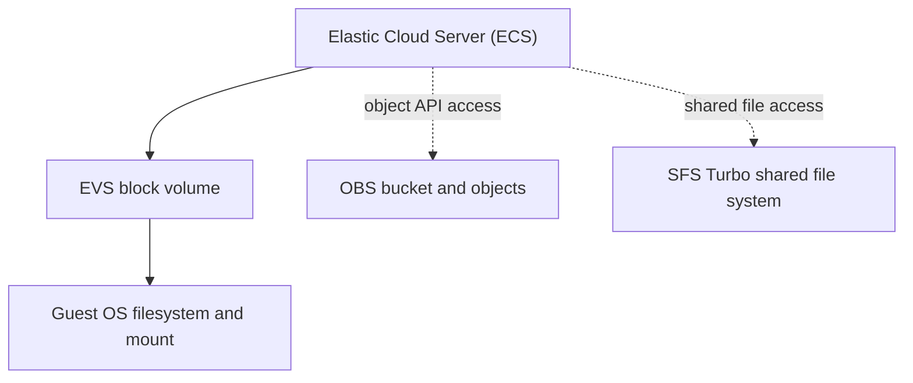

# Huawei Cloud Storage Services: EVS, OBS and SFS Turbo

> Hands-on storage exercise covering block storage, object storage, and shared file storage on Huawei Cloud.

**Platform:** Huawei Cloud  
**Training:** HCCDP Solution Architecture  
**Region shown in console evidence:** AP-Singapore  
**Evidence status:** EVS and limited OBS evidence documented; SFS remains unverified.

## 1. Objectives

The training exercise covers three Huawei Cloud storage services:

1. **EVS (Elastic Volume Service):** block storage attached to ECS instances.
2. **OBS (Object Storage Service):** object storage organized into buckets and objects.
3. **SFS Turbo (Scalable File Service):** managed shared file storage accessed by supported clients.

The exercise outline includes preparing EVS disks on Windows and Linux, managing OBS buckets and objects, and provisioning/mounting SFS Turbo. This README separates the exercise objectives from the results demonstrated by the available screenshots.

## 2. EVS — Elastic Volume Service

EVS provides persistent block volumes that can be attached to ECS instances and prepared by the guest operating system.

### Linux disk preparation

The terminal evidence shows the following operations on a Linux ECS:

1. `fdisk -l` identifies an additional 21.5 GB block device at `/dev/vdb`.
2. A primary Linux partition, `/dev/vdb1`, is created with an approximate size of 10 GiB.
3. `mkfs -t ext4 /dev/vdb1` creates an ext4 filesystem.
4. The mount point `/mnt/sdc` is created.
5. An initial mount command is malformed; the corrected command `mount /dev/vdb1 /mnt/sdc` succeeds.
6. `df -TH` lists `/dev/vdb1` as an ext4 filesystem mounted at `/mnt/sdc`.

A separate terminal capture shows a different partition, `/dev/vdc1`, mounted at `/mnt/sdc`. The later attempt to change into `/mnt/sdc/snapshot` fails because that path does not exist. The command `cat test.file` then reads a file from the shell's current directory. This is **not** evidence that the file was read from the mounted filesystem.

### Windows disk view

The Windows Disk Management capture shows:

- Disk 1 online with a capacity of 20 GB.
- A 20 GB NTFS volume assigned drive letter `D:`.
- The volume status displayed as Healthy (Primary Partition).

The screenshot shows the resulting disk/volume state; it does not show the complete initialization and formatting sequence.

### EVS inventory and supporting ECS context

The EVS inventory screenshot shows volumes in **In-use** and **Detaching** states. It is a point-in-time inventory and does not establish the complete attachment/detachment lifecycle. The ECS inventory screenshot displays three instances in **Running** state; it provides environment context rather than proof of a storage operation.

### EVS evidence

| Screenshot | What it supports | Limitation |
|---|---|---|
| [Windows Disk Management](Screenshots/01-windows-disk-management.png) | A 20 GB NTFS `D:` volume is online and healthy | Initial disk setup steps are not shown |
| [EVS volume inventory](Screenshots/02-evs-volume-inventory.jpg) | EVS inventory includes In-use and Detaching volumes | Does not prove the full lifecycle |
| [ECS instance inventory](Screenshots/03-ecs-instance-inventory.jpg) | Three ECS instances are displayed as Running | Context only; not storage verification |
| [Linux disk partition table](Screenshots/04-linux-disk-partition-table.png) | An additional `/dev/vdb` disk is visible | Does not alone prove cloud attachment details |
| [Linux partition creation](Screenshots/05-linux-partition-creation.png) | A Linux partition `/dev/vdb1` is created | Partitioning only |
| [Linux ext4 formatting](Screenshots/06-linux-ext4-formatting.png) | `/dev/vdb1` is formatted as ext4 | Does not prove persistence after reboot |
| [Linux filesystem mount](Screenshots/07-linux-filesystem-mount.png) | Corrected mount command succeeds; `df -TH` lists ext4 at `/mnt/sdc` | Does not show reboot persistence |
| [Linux file-read attempt](Screenshots/08-linux-file-read-test.png) | A separate `/dev/vdc1` mount succeeds and `test.file` is read | The file read is from the current directory, not proven to be from the mount |

## 3. OBS — Object Storage Service

The OBS Task Center screenshot displays a successful task record for an object named `obs-test` in a bucket named `bucket-vivi`, with a reported size of **0 Bytes**.

This is limited evidence of a successful task record for a zero-byte object. It does not establish a non-empty upload/download, content integrity, or the complete bucket lifecycle.

| Screenshot | What it supports | Limitation |
|---|---|---|
| [OBS task result](Screenshots/09-obs-task-success-zero-byte-object.jpg) | Task Center shows `obs-test` in `bucket-vivi` as Succeeded, size 0 Bytes | No non-empty upload/download or integrity test is demonstrated |

Useful follow-up evidence would include a non-empty test file upload and download, matching file size or checksum, and deletion confirmation if performed.

## 4. Supporting network context

The EIP screenshot is retained as supporting Huawei Cloud console evidence, not as proof of an EVS, OBS, or SFS operation. It shows the console confirmation that EIP `119.8.174.201` was bound to an ECS successfully.

- [EIP bound to ECS](Screenshots/10-eip-bound-to-ecs.jpg)

## 5. SFS Turbo — shared file storage

The exercise outline includes creating an SFS Turbo file system and mounting it to Linux and Windows ECS instances. The available screenshot set does not contain an SFS resource, provisioning status, or client mount. SFS is therefore recorded as **not verified**; no completion claim is made.

To verify this part of the exercise, capture:
- SFS Turbo resource details and an Available/usable status.
- Linux NFS client setup and mount verification.
- Windows client setup and mount verification, if included in the lab.
- A shared-file test showing access from the intended clients.

## 6. Conceptual storage overview

The diagram below summarizes the service roles; it is conceptual and does not claim that all three services were deployed or integrated in this exercise.

## 7. Verification summary

| Service | Demonstrated by available evidence | Not established |
|---|---|---|
| EVS | Windows NTFS volume view; Linux partitioning, ext4 formatting, and successful mount | Full cloud attachment lifecycle, reboot persistence, snapshot/restore, and verified file I/O on the mounted path |
| OBS | Successful Task Center record for a zero-byte object | Non-empty upload/download, checksum validation, and full bucket lifecycle |
| SFS Turbo | Included in the training objectives only | Provisioning, Linux/Windows mounts, and cross-client shared-file access |

## 8. Publication and evidence notes

The original screenshot set also included two terminal captures whose browser address bars exposed Remote VNC session-token URLs. Those two captures (DNS tools installation and mount-command help) are intentionally not included in this public evidence set. Treat any previously exposed session token as compromised and invalidate or allow it to expire where the training platform permits.

Other visible sandbox account/agency identifiers, resource names, and the temporary EIP are retained as contextual lab evidence; they are not presented as credentials. Review them again if the screenshots are reused outside this controlled training-portfolio context.

No Huawei Cloud resources were changed as part of this repository documentation work.
