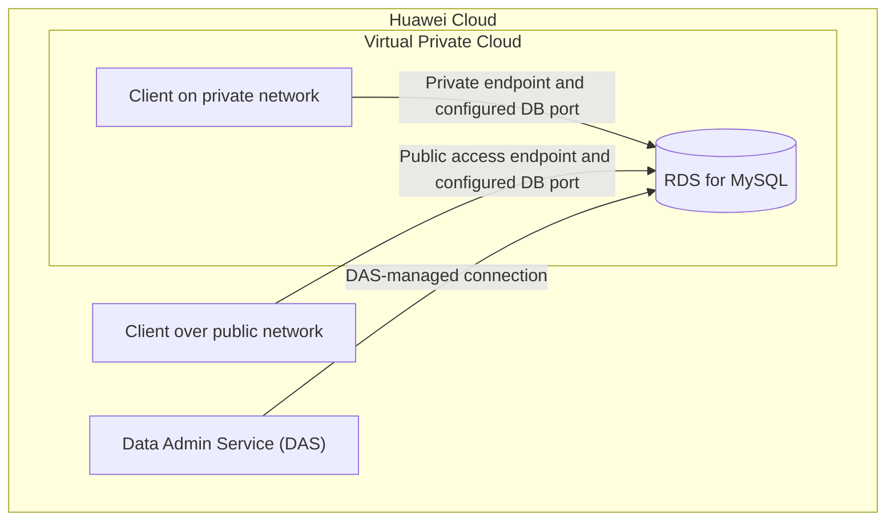

# Huawei Cloud RDS for MySQL: Instance Management and Connectivity

> Hands-on database-service exercise covering RDS for MySQL provisioning, backup-policy configuration, database-port modification, and connection testing through different access paths.

**Platform:** Huawei Cloud  
**Service:** Relational Database Service (RDS) for MySQL  
**Exercise type:** Guided hands-on training lab  
**Status:** Completed

## 1. Objective

Work with a managed MySQL database instance on Huawei Cloud and practice its basic administration and connectivity options.

The exercise focused on:

- Purchasing and performing basic operations on an RDS for MySQL instance.
- Modifying the automated backup policy.
- Changing the database connection port.
- Connecting to the database through Data Admin Service (DAS).
- Connecting through a private network.
- Connecting through a public network.

## 2. Services and components

- **Huawei Cloud RDS for MySQL** — managed relational database instance.
- **Data Admin Service (DAS)** — browser-based database access and administration.
- **Private network connectivity** — connection to the database through its private network endpoint.
- **Public network connectivity** — connection through the instance's public access path when enabled.

## 3. Architecture and access paths

The exercise covered three ways of reaching the managed database. The diagram below shows the logical access paths; it does not imply that the DAS console, private client, and public client were all hosted in the same network.

**Access paths practiced:**

1. **DAS:** accessed the RDS instance through the Huawei Cloud console's database administration service.
2. **Private network:** connected to the database using its private network connection details.
3. **Public network:** connected through the public access path after the required public connectivity configuration.

## 4. Implementation

### 4.1 RDS for MySQL instance provisioning

- Accessed the Huawei Cloud console.
- Purchased an RDS for MySQL DB instance.
- Performed the basic instance operations covered in the exercise.

### 4.2 Automated backup policy

- Opened the instance's backup-policy settings.
- Modified the automated backup policy.
- Reviewed the role of scheduled backups in database recovery and operational continuity.

### 4.3 Database port modification

- Accessed the RDS instance's connection configuration.
- Changed the database port.
- Used the configured port when working with the database connection methods.

> The exact port number and backup schedule are intentionally not stated here because they were not included in the exercise notes provided for this documentation.

### 4.4 Connecting through DAS

- Opened Data Admin Service from the Huawei Cloud console.
- Selected the RDS for MySQL instance.
- Established a database session through DAS.

### 4.5 Connecting through a private network

- Used the private network connection method for the RDS instance.
- Tested database connectivity through the private endpoint and configured database port.

### 4.6 Connecting through a public network

- Used the public network connection method for the RDS instance.
- Tested connectivity through the public access path and configured database port.

## 5. Verification

The exercise covered successful connection to the RDS for MySQL instance through:

- Data Admin Service (DAS).
- Private network connectivity.
- Public network connectivity.

For a stronger evidence trail, add sanitized screenshots showing:

| Suggested evidence | What it should demonstrate |
|---|---|
| `rds-instance-overview.png` | RDS for MySQL instance and its status |
| `backup-policy.png` | Updated automated backup policy |
| `database-port.png` | Modified database port |
| `das-connection.png` | Database session through DAS |
| `private-network-connection.png` | Successful private network connection |
| `public-network-connection.png` | Successful public network connection |

Only add screenshots that you personally captured and verify. Remove account IDs, passwords, connection credentials, and sensitive public IP information before publishing.

## 6. Security and operational considerations

- Prefer private connectivity when the application and database can communicate within the same cloud network.
- If public connectivity is required, restrict inbound access to trusted source IP addresses and the required database port.
- Avoid exposing database credentials in screenshots, source files, terminal history, or repository commits.
- Automated backups support recovery planning, but the retention period and restore process should also be reviewed.
- A custom database port does not replace authentication, network restrictions, or encryption.

These are operational considerations; they should not be interpreted as additional controls configured during this exercise unless supported by separate evidence.

## 7. Key takeaways

- Gained practical exposure to provisioning and managing a Huawei Cloud RDS for MySQL instance.
- Worked with automated backup settings and database-port configuration.
- Practiced three database access methods: DAS, private network, and public network.
- Observed how connectivity choices affect database accessibility and security boundaries.

## 8. Cleanup and cost

RDS instances and public connectivity resources can incur charges while they remain provisioned. Confirm that the training resources have been released according to the lab instructions and the training account's cleanup process.

## 9. Possible improvements

- Document the exact backup retention and schedule settings used.
- Record the configured database port and connection test method.
- Add sanitized screenshots for each completed stage.
- Test access restrictions from an untrusted source to verify the intended network boundary.
