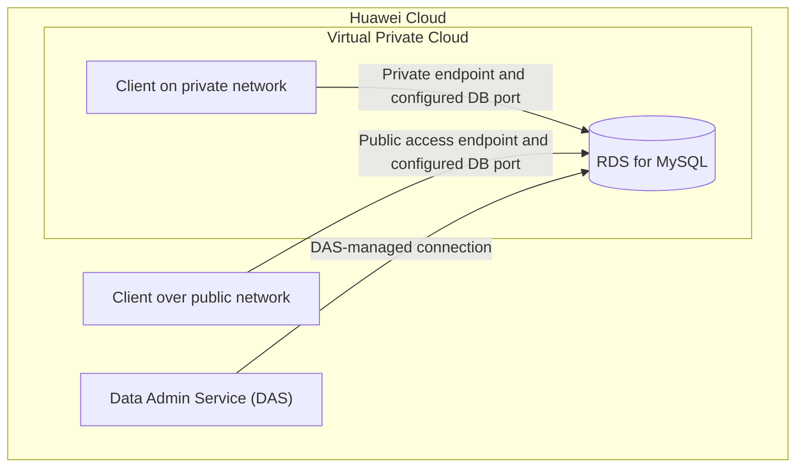

# Huawei Cloud RDS for MySQL: Instance Management and Connectivity

> Hands-on database-service exercise covering RDS for MySQL provisioning, backup-policy configuration, database-port modification, and connection testing through different access paths.

**Platform:** Huawei Cloud  
**Service:** Relational Database Service (RDS) for MySQL  
**Exercise type:** Guided hands-on training lab  
**Region shown in console evidence:** AP-Singapore  
**Status:** Completed

## 1. Objective

Work with a managed MySQL database instance on Huawei Cloud and practice its basic administration and connectivity options.

The exercise focused on:

- Purchasing and performing basic operations on an RDS for MySQL instance.
- Modifying the automated backup policy.
- Changing the database connection port.
- Connecting to the database through Data Admin Service (DAS).
- Connecting through a private network.
- Connecting through a public network.

## 2. Services and components

- **Huawei Cloud RDS for MySQL** — managed relational database instance.
- **Data Admin Service (DAS)** — browser-based database access and administration.
- **Private network connectivity** — connection to the database through its private network endpoint.
- **Public network connectivity** — connection through the instance's public access path when enabled.
- **Security groups** — network access rules associated with the RDS connectivity configuration.

## 3. Architecture and access paths

The exercise covered three ways of reaching the managed database. The diagram below shows the logical access paths; it does not imply that the DAS console, private client, and public client were all hosted in the same network.

**Access paths practiced:**

1. **DAS:** accessed the RDS instance through the Huawei Cloud console's database administration service.
2. **Private network:** connected to the database using its private network connection details.
3. **Public network:** connected through the public access path after the required public connectivity configuration.

## 4. Implementation

### 4.1 RDS for MySQL instance provisioning

- Accessed the Huawei Cloud console.
- Purchased an RDS for MySQL DB instance.
- The console evidence shows one instance and an `Available` status.
- The region selector in the captured console shows **AP-Singapore**.

### 4.2 Automated backup policy

- Opened the instance's backup-policy settings.
- Modified the automated backup policy.
- Reviewed the role of scheduled backups in database recovery and operational continuity.

The supplied screenshots do not show the final backup schedule or retention values, so those settings are not specified here.

### 4.3 Database port modification

- Accessed the RDS instance's connection configuration.
- Changed the database port.
- Used the configured port when working with the database connection methods.

The exact modified database port is not legible in the supplied evidence and is therefore not stated.

### 4.4 Connecting through DAS

- Opened Data Admin Service from the Huawei Cloud console.
- Selected the RDS for MySQL database.
- Used the SQL editor to execute a `CREATE TABLE person` statement.
- The visible statement defines `number INT(11)`, `name VARCHAR(255)`, and `birthday DATE`; the DAS execution history shows a duration of **9 ms** for the displayed statement.

### 4.5 Connecting through a private network

- Used the private network connection method for the RDS instance.
- Tested database connectivity through the private endpoint and configured database port.

### 4.6 Connecting through a public network

- Used the public network connection method for the RDS instance.
- The supplied console capture shows the **Public Connection** topology tab selected.
- Tested connectivity through the public access path and configured database port.

## 5. Verification and evidence reviewed

The supplied collages provide the following visible evidence:

| Evidence | What is visible |
|---|---|
| RDS instance overview | One instance in the console; status shown as **Available**; region shown as AP-Singapore |
| DAS SQL editor | A `CREATE TABLE person` statement and an execution-history entry showing 9 ms |
| Connection topology | Public Connection tab selected for the RDS instance |
| Security group inbound rules | Four inbound rows are visible under security group `sg-hce` |
| MySQL client environment | Terminal output includes package/version text `8.0.46-1.hce2` |
| Database terminal | A MySQL terminal session is visible, but the collage crop does not show enough context to independently verify the complete connection command and result |

The security-group capture shows inbound **TCP 3306** and **TCP 22** rules. Their source fields visibly begin with `0.0.0.0`, but the right edge of the collage is cropped, so the complete CIDR values cannot be confirmed from this evidence. Two additional rows show **All** traffic associated with security group `sg-hce`, one under IPv4 and one under IPv6.

The screenshots supplied in chat have been reviewed as documentation evidence; they have not been added as image files to this repository. Before publishing original screenshots, remove credentials, account identifiers, and sensitive public IP details.

## 6. Security and operational considerations

- Prefer private connectivity when the application and database can communicate within the same cloud network.
- If public connectivity is required, restrict inbound access to trusted source IP addresses and the required database port.
- **Review the inbound TCP 3306 and TCP 22 rules before using this configuration outside the training environment.** The captured source values begin with `0.0.0.0`; because the full CIDR is cropped, the exact exposure cannot be established from the image alone. If either rule uses `0.0.0.0/0`, it permits connections from any IPv4 address and should be narrowed to trusted source addresses. SSH access to a database instance should only be enabled when specifically required.
- Avoid exposing database credentials in screenshots, source files, terminal history, or repository commits.
- Automated backups support recovery planning, but the retention period and restore process should also be reviewed.
- A custom database port does not replace authentication, network restrictions, or encryption.

These are operational considerations; they should not be interpreted as additional controls configured during this exercise unless supported by separate evidence.

## 7. Key takeaways

- Gained practical exposure to provisioning and managing a Huawei Cloud RDS for MySQL instance.
- Worked with automated backup settings and database-port configuration.
- Practiced database access through DAS and the private/public connectivity options.
- Executed a basic SQL table-creation statement through DAS.
- Observed how security-group rules and connectivity choices affect database exposure.

## 8. Cleanup and cost

RDS instances and public connectivity resources can incur charges while they remain provisioned. Confirm that the training resources have been released according to the lab instructions and the training account's cleanup process.

## 9. Possible improvements

- Record the exact backup retention and schedule settings used.
- Record the modified database port.
- Capture the full source CIDR values for the inbound security-group rules.
- Verify that public database access is limited to the intended client IP addresses.
- Add sanitized, original screenshots to an `evidence/` or `screenshots/` directory in the repository.
- Test access restrictions from an untrusted source to verify the intended network boundary.
