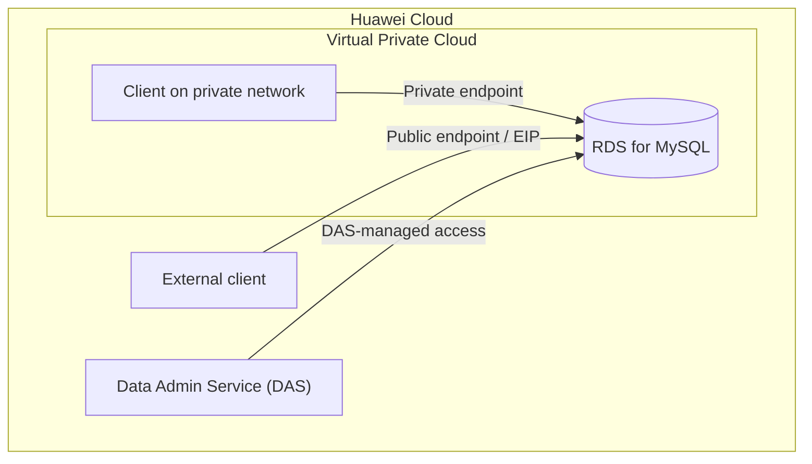

# Huawei Cloud RDS for MySQL: Instance Management and Connectivity

> Hands-on training exercise covering managed MySQL provisioning, database administration, and network-access configuration on Huawei Cloud.

**Platform:** Huawei Cloud  
**Service:** Relational Database Service (RDS) for MySQL  
**Exercise type:** Guided hands-on training lab  
**Region shown in console captures:** AP-Singapore  
**Status:** Exercise documented; original screenshots reviewed but withheld pending redaction

## 1. Objective

Practice basic administration of a managed MySQL instance and understand the differences between console-based database administration, private connectivity, and public connectivity.

The training exercise covered:

- Provisioning an RDS for MySQL instance and reviewing its basic status.
- Reviewing automated backup-policy settings.
- Initiating a database-port modification.
- Accessing the database through Data Admin Service (DAS).
- Exploring private and public connection options.
- Reviewing the security-group rules associated with database access.

## 2. Services and components

- **Huawei Cloud RDS for MySQL** — managed relational database service.
- **Data Admin Service (DAS)** — browser-based database administration.
- **VPC/private connectivity** — private network access to cloud resources.
- **Public connectivity/EIP** — an optional public access path.
- **Security groups** — network rules controlling allowed inbound and outbound traffic.

## 3. Logical access paths

The following is a conceptual view of the access methods explored. It is not a verified production topology and does not imply that all clients were deployed in the same network.

## 4. Activities performed

### 4.1 RDS instance provisioning

- Accessed the Huawei Cloud console and opened RDS.
- The reviewed console capture shows one MySQL instance with status **Available**.
- The region selector shows **AP-Singapore**.

### 4.2 Backup-policy review

The exercise included reviewing and modifying automated backup settings. The screenshots reviewed do not show the final backup schedule or retention values, so no specific configuration is claimed here.

### 4.3 Database-port change

A console notification confirms that a database-port change operation was initiated. However, the same capture visibly shows port **3306**, and there is no final-state capture confirming a different port. The final configured port is therefore **unverified**.

### 4.4 DAS database administration

The DAS SQL editor shows a `CREATE TABLE person` statement with the columns `number INT(11)`, `name VARCHAR(255)`, and `birthday DATE`. The execution history displays a duration of **9 ms** for that statement.

### 4.5 MySQL client practice

The terminal captures show a MySQL client session and successful SQL operations, including:

- `SHOW DATABASES;`
- `USE rds-whj;`
- `SHOW TABLES;`
- `CREATE DATABASE test;`

The terminal output confirms that these SQL commands completed in the displayed MySQL session. The screenshots do not show the full connection command or endpoint, so they do not independently establish whether that client session connected through the private endpoint or the public endpoint.

### 4.6 Private and public connectivity

The console capture shows the **Public Connection** topology view, including a public EIP path. The exercise also covered private connection details. The reviewed screenshots do not provide a complete end-to-end client connection test for each path, so the two connectivity methods are documented as training activities rather than independently verified successful network tests.

## 5. Evidence review

The original captures were reviewed from the supplied branch folder. They are not included in this public-facing lab record yet because they expose account context, resource identifiers, and public network details.

| Evidence reviewed | What it supports | Limitation |
|---|---|---|
| RDS instance overview | One instance shown as **Available** in AP-Singapore | Account and resource identifiers should be masked |
| Database-port notification | A port-change operation was initiated | Final port value is not verified; 3306 remains visible |
| DAS SQL editor | A `CREATE TABLE person` statement and 9 ms execution-history entry | Does not show the complete resulting table contents |
| MySQL terminal | Successful database/table listing and database creation commands | Full connection command and endpoint are not visible |
| Public connection topology | Public Connection view and EIP path are displayed | Does not prove an external client successfully connected |
| Security-group inbound rules | TCP 3306 and TCP 22 rules, plus two self-referencing All-traffic rules | Shows a broad IPv4 exposure that requires correction |

### Security finding from the reviewed console capture

The inbound security-group screenshot visibly shows:

- **TCP 3306** — source **0.0.0.0/0**
- **TCP 22** — source **0.0.0.0/0**
- **All traffic** — source security group `sg-hce` (IPv4)
- **All traffic** — source security group `sg-hce` (IPv6)

The two IPv4 rules allow connections from any IPv4 address to the listed ports. In particular, exposing a database port to the entire internet is not an appropriate default configuration. SSH should also not be open globally. These rules are recorded as a security observation from the training screenshot, **not as a recommended configuration**.

## 6. Security and operational recommendations

- Prefer private RDS connectivity for applications running within the same cloud network.
- Remove public access when it is not required.
- If public access is necessary for a controlled test, restrict the source to a specific trusted client IP or narrow CIDR; never leave database access open to `0.0.0.0/0`.
- Restrict SSH to a dedicated trusted management source, and disable the rule when it is not needed.
- Review IPv4 and IPv6 rules separately; a restrictive IPv4 rule does not automatically secure IPv6.
- Use strong database credentials and TLS where supported.
- Verify backup schedules and perform a restore test rather than assuming that an enabled backup policy guarantees recoverability.
- Confirm the final database port and test reachability from only the intended client network.

These are recommendations based on the observed configuration and general cloud-security practice. They are not claims that these controls were implemented during the exercise.

## 7. Key takeaways

- Practiced navigating and managing a Huawei Cloud RDS for MySQL instance.
- Used DAS to execute a SQL table-creation statement.
- Practiced basic MySQL database and table-management commands.
- Explored private and public connectivity options.
- Identified the security implications of unrestricted inbound database and SSH rules.

## 8. Cleanup and cost awareness

RDS instances and associated public connectivity resources may incur charges while provisioned. Confirm that training resources have been stopped or released according to the course instructions and the training-account cleanup process.

## 9. Evidence still needed for a stronger portfolio record

- A sanitized RDS overview with account and resource identifiers masked.
- A final-state capture confirming the actual database port.
- A sanitized backup-policy view showing schedule and retention.
- A successful private-client connection test with the endpoint partially masked.
- A separate public-client test, if public access is part of the learning objective, using a source-restricted rule.
- A corrected security-group view showing TCP 3306 restricted to a trusted source and no unnecessary global SSH rule.
- A SQL verification capture showing the table/database operation and the target instance context without exposing credentials or public IPs.
