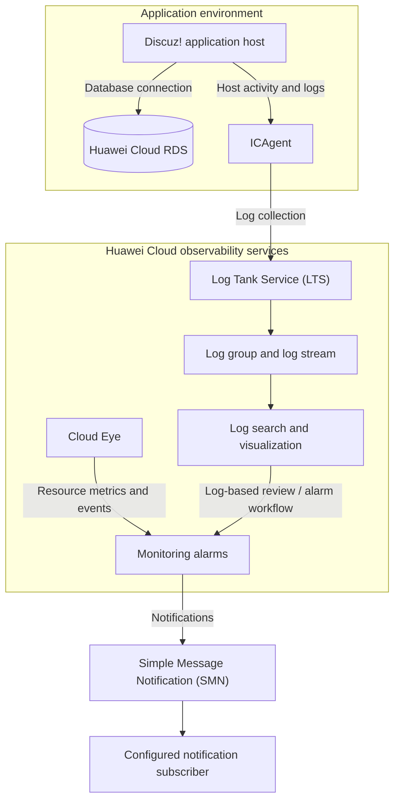

# Huawei Cloud O&M Solution: Monitoring, Log Management, and Alarming

> Guided hands-on exercise covering cloud resource monitoring, host-log collection, log analysis, and alarm notification workflows on Huawei Cloud.

**Platform:** Huawei Cloud  
**Primary services:** Cloud Eye, Log Tank Service (LTS), Simple Message Notification (SMN), ICAgent  
**Supporting services:** VPC, security groups, RDS  
**Exercise type:** Guided hands-on training lab  
**Status:** Lab completed; 12 implementation screenshots included

## 1. Objective

Practice the core building blocks of a cloud operations and monitoring (O&M) solution:

- Monitor cloud-service resource metrics.
- Review service events and configure alarm notification topics.
- Collect host logs using ICAgent and ingest them into LTS.
- Organize logs into log groups and log streams for analysis.
- Deliver alarm notifications through SMN.

This record describes the activities covered by the completed training exercise. It is not a claim of a production deployment or a production-grade observability platform.

## 2. Services and components

| Service | Role in the exercise |
|---|---|
| **Cloud Eye** | Observe cloud-resource metrics and events; configure monitoring-based alarms. |
| **Log Tank Service (LTS)** | Create log groups and streams, ingest host logs, and support log search, visualization, and analysis. |
| **ICAgent** | Collect host log data and forward it to LTS. |
| **Simple Message Notification (SMN)** | Provide a notification topic and deliver alarm messages to configured subscribers. |
| **RDS** | Provide the database service used by the supporting Discuz! application environment. |
| **VPC and security groups** | Provide network segmentation and access control for the supporting environment. |

## 3. Conceptual architecture

The diagram summarizes the monitoring and log-flow concepts practiced in the lab. It is a logical representation of the exercise, not a verified production topology.

The diagram shows the main service relationships at a conceptual level. It does not imply that a specific log-based alarm rule, end-to-end notification delivery, or automated remediation was configured unless supported by separate evidence.

## 4. Implementation workflow

### 4.1 Supporting environment

The exercise began with the supporting cloud environment:

- Created the database subnet.
- Created and configured the database security group.
- Provisioned an RDS DB instance.
- Installed Discuz! and connected it to the RDS database.

These components provided an application environment for the monitoring and log-management activities.

### 4.2 Cloud-service resource monitoring

- Opened Cloud Eye to review cloud-service resource metrics.
- Practiced monitoring resource performance through service metrics.
- Reviewed cloud events and the monitoring workflow.
- Configured an SMN topic for alarm notification.

**Operational purpose:** Metrics and events help operators identify resource conditions that may require investigation. Alarm thresholds should be selected according to workload behavior and service requirements rather than copied blindly from a tutorial.

### 4.3 Log collection and analysis

- Created LTS log groups and log streams.
- Installed ICAgent on the host used by the exercise.
- Configured host-log ingestion into LTS.
- Practiced viewing and analyzing ingested logs.

**Operational purpose:** Centralized log collection makes host activity easier to search and investigate without relying exclusively on interactive access to individual servers.

### 4.4 Alarm notification

- Configured the SMN notification workflow used by the exercise.
- Practiced pushing alarm notifications through the configured SMN topic.

**Operational purpose:** Notifications help route monitoring events to an operator or subscribed endpoint so that an issue can be investigated promptly.

## 5. Verification and evidence status

The lab is recorded as completed based on the guided exercise activities. The repository includes screenshots for the supporting network and application environment, RDS provisioning, Cloud Eye resource metrics, an ECS restart event, and an enabled event-based alarm rule. The screenshots do not independently evidence the LTS, ICAgent, or SMN configuration steps, nor do they prove end-to-end notification delivery.

| Area | Activity covered | Public evidence in this repository |
|---|---|---|
| Supporting environment | Subnets and security groups | [01 – VPC subnets](Screenshots/01-vpc-subnets.png), [02 – Security groups](Screenshots/02-security-groups.png) |
| RDS and application | RDS instance and Discuz! database/application setup | [03 – RDS instance](Screenshots/03-rds-instance.png), [04 – Discuz! installation check](Screenshots/04-discuz-installation-check.png), [05 – Database installation](Screenshots/05-discuz-database-installation.png), [06 – Forum running](Screenshots/06-discuz-forum-running.png) |
| Cloud Eye | Resource metrics | [07](Screenshots/07-cloud-eye-resource-metrics-01.png), [08](Screenshots/08-cloud-eye-resource-metrics-02.png), [09 – Request metrics](Screenshots/09-cloud-eye-request-metrics.png) |
| Cloud Eye events and alarms | ECS restart event, event visualization, and enabled alarm rule | [10 – ECS restart event](Screenshots/10-cloud-eye-ecs-restart-event.png), [11 – Event visualization](Screenshots/11-cloud-eye-event-visualization.png), [12 – Alarm rule](Screenshots/12-cloud-eye-alarm-rule.png) |
| LTS, ICAgent, and SMN | Activities covered in the guided lab | No screenshots retained; not independently evidenced in this repository |

When adding screenshots, redact account identifiers, usernames, internal IP addresses where sensitive, public IPs, database endpoints, credentials, tokens, and any other account-specific information.

## 6. Security and operational considerations

- Apply least-privilege access to Cloud Eye, LTS, SMN, and host-management permissions.
- Restrict security-group rules to the required sources, destinations, and ports.
- Protect log data because logs can contain usernames, internal hostnames, IP addresses, request details, and other sensitive operational information.
- Define log retention according to operational, compliance, and cost requirements.
- Avoid placing passwords, access keys, tokens, or database connection secrets in log messages.
- Use meaningful alarm thresholds and notification routing to reduce noisy or duplicate alerts.
- Test notification subscriptions and delivery paths; configuring a topic alone does not prove that a subscriber received an alarm.
- Review ICAgent health and log ingestion status so collection gaps are detected.
- Monitor LTS ingestion and retention costs as log volume grows.

These are operational recommendations, not claims that every control was configured during the guided exercise.

## 7. Key takeaways

This exercise provided hands-on exposure to:

- Cloud-resource metrics and event monitoring with Cloud Eye.
- Alarm notification concepts using SMN.
- Centralized host-log collection using ICAgent and LTS.
- Log grouping, ingestion, visualization, and analysis.
- The relationship between monitoring, log visibility, and operational response.

## 8. Scope and limitations

- This was a guided training lab, not a production rollout.
- No specific metric thresholds, retention periods, log volume, or alert-delivery latency are claimed.
- The repository contains 12 screenshots of selected implementation steps; LTS, ICAgent, and SMN evidence was not retained.
- No automated remediation, incident-management integration, or high-availability monitoring design is claimed.

## 9. Cleanup and cost awareness

Cloud resources such as RDS instances and supporting compute resources may incur charges while provisioned. LTS ingestion and retention, monitoring features, and notification usage may also have cost implications depending on the service configuration and region. Review the training instructions and release resources that are no longer required.
