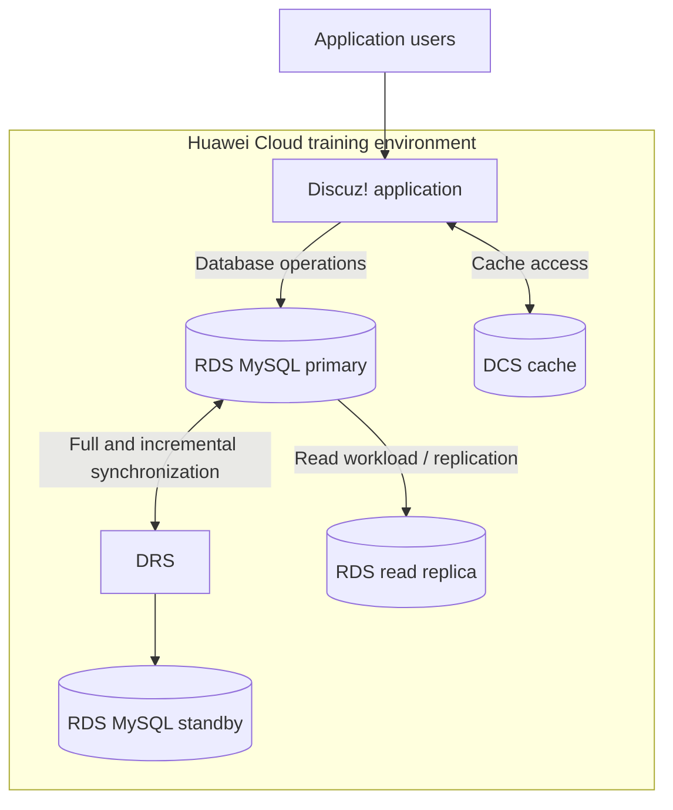

# Huawei Cloud Highly Reliable Database Solution

> Hands-on Huawei Cloud training exercise covering managed database availability, data replication, read scaling, and application caching.

**Platform:** Huawei Cloud  
**Exercise type:** Guided hands-on sandbox lab  
**Completion:** Completed  
**Primary services:** RDS for MySQL, Data Replication Service (DRS), Distributed Cache Service (DCS)  
**Application context:** Discuz!  
**Environment:** Huawei Cloud training sandbox

## 1. Objective

Explore how a cloud-hosted application can use managed database services and caching to improve data availability, support read workloads, and reduce repeated database access.

The exercise focused on:

- Building an RDS primary-and-standby database arrangement.
- Practicing full and incremental data synchronization with DRS.
- Exploring an RDS read replica for read-oriented workloads.
- Creating and integrating a DCS cache instance with the Discuz! application.

This was a guided sandbox exercise, not a production deployment or a formal high-availability benchmark.

## 2. Services and components

- **Relational Database Service (RDS) for MySQL** — managed relational database instances used for the application data layer.
- **Data Replication Service (DRS)** — used to perform full and incremental data synchronization in the lab.
- **RDS read replica** — a separate read-oriented database instance for exploring read scaling.
- **Distributed Cache Service (DCS)** — managed caching service integrated with the application.
- **Discuz!** — application used to provide a practical database and cache integration context.
- **VPC, subnets, and security groups** — network foundations for database and application connectivity.

## 3. Logical architecture

The diagram summarizes the components and relationships practiced in the exercise. It is a logical representation of the lab, not a production topology or a measured failover design.

### Architecture notes

- The RDS primary and standby arrangement introduced the managed database high-availability model.
- DRS was used in the exercise for full and incremental data synchronization between database instances.
- The read replica represented a read-scaling option distinct from the primary/standby availability arrangement.
- DCS was connected to the Discuz! application to practice application-level caching.

The diagram is intentionally conceptual: it does not specify an exact replication topology, endpoint configuration, consistency guarantee, or failover result beyond the activities described above.

## 4. Implementation activities

### 4.1 RDS primary and standby

- Worked with Huawei Cloud RDS for MySQL.
- Set up the primary-and-standby database arrangement in the training environment.
- Reviewed the database instances and their roles as part of the high-availability exercise.

### 4.2 DRS full and incremental synchronization

- Used Data Replication Service to perform a full synchronization.
- Practiced incremental synchronization after the full synchronization stage.
- Explored how DRS can keep data synchronized between database instances.

### 4.3 RDS read replica

- Created or configured an RDS read replica as part of the exercise.
- Reviewed the role of a read replica in serving read-oriented workloads.
- Compared the read-replica use case with the primary/standby availability model.

### 4.4 DCS cache integration

- Worked with a Huawei Cloud DCS instance.
- Integrated the cache service with the Discuz! application in the lab.
- Explored how caching can reduce repeated database reads for frequently requested application data.

### 4.5 Supporting network configuration

- Worked with the VPC, subnet, and security-group settings required by the lab resources.
- Used the cloud network configuration to support communication between the application and managed data services.

## 5. Verification and results

The exercise covered the following configuration and workflow areas:

| Area | Lab activity | What it demonstrates |
|---|---|---|
| RDS high availability | Primary-and-standby arrangement | Familiarity with managed database availability concepts |
| DRS | Full and incremental synchronization | Understanding of initial and subsequent data synchronization stages |
| RDS read replica | Read replica setup | Exposure to read scaling for database workloads |
| DCS | Cache instance and Discuz! integration | Practical application-level caching concepts |
| Networking | VPC, subnet, and security-group setup | Understanding of network prerequisites for cloud data services |

**Evidence note:** This README records the lab activities completed in the training sandbox. Console screenshots and independent test outputs are not included in this project folder at this stage. No specific replication lag, throughput, failover time, recovery-point objective (RPO), or recovery-time objective (RTO) is claimed.

## 6. Security and operational considerations

The following are operational recommendations for a real deployment; they should not be interpreted as controls verified in this training exercise.

- Keep database instances on private network paths wherever possible.
- Restrict database security-group rules to the application and approved administration sources.
- Store database credentials securely and avoid embedding secrets in application configuration or source control.
- Use encryption in transit where supported and configure appropriate certificate validation.
- Monitor database health, storage, connections, replication status, and cache utilization.
- Define and test backup retention and restoration procedures.
- Test failover behavior and application reconnection handling before relying on a high-availability design.
- Validate read-after-write and consistency requirements before directing application reads to a replica.
- Define cache expiration and invalidation behavior so stale data does not create application correctness issues.
- Review service sizing and remove sandbox resources after the exercise to avoid unnecessary charges.

## 7. Key takeaways

- Practiced the role of RDS primary-and-standby arrangements in managed database availability.
- Explored full and incremental synchronization workflows using DRS.
- Learned how read replicas can support read-oriented database workloads.
- Integrated DCS caching with a Discuz! application in a training environment.
- Strengthened understanding of the relationship between application services, managed databases, caching, and cloud networking.

## 8. Cleanup and cost awareness

RDS instances, read replicas, DCS instances, and related network resources may incur charges while provisioned. Check the Huawei Cloud training environment and release or stop resources according to the sandbox instructions when the exercise is complete.

## 9. Possible improvements

- Add sanitized console screenshots showing the RDS primary/standby arrangement, DRS synchronization status, read replica, and DCS integration.
- Capture a controlled data-change test to demonstrate the result of incremental synchronization.
- Record a read-replica query test and clearly identify the endpoint used.
- Measure cache hit/miss behavior if the application and sandbox expose suitable metrics.
- Perform a controlled failover and document application behavior, recovery time, and any observed limitations.
- Add monitoring and backup/restore validation to make the operational story more complete.
